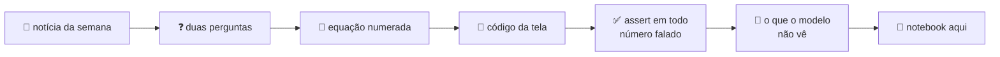

<!-- Episódio novo: python motor/repo.py (da pasta fqz) copia o notebook e os dados; aqui, uma linha na tabela da
     temporada, um quadrado 🟦 no mapa, o número no selo "episódios com código" e no "Já tem código para N". -->

<div align="center">


# Finanças Quantitativas do Zero

**Do cassino à curva de juros, uma linha de numpy por vez.**

Os notebooks da série do Instagram [@gabrielp.pires](https://instagram.com/gabrielp.pires): cada vídeo vira código que roda, com dado de verdade.

[](#-comece-em-30-segundos)
[](#-os-episódios)
[](#-os-episódios)
[](https://instagram.com/gabrielp.pires)
[](https://gabrielppires.com)
[](LICENSE)


[O que é](#-o-que-é-isto) · [Comece](#-comece-em-30-segundos) · [Episódios](#-os-episódios) · [O mapa](#-o-mapa-da-série) · [Regras da casa](#-regras-da-casa) · [Dados](#-de-onde-vêm-os-dados) · [FAQ](#-perguntas-que-sempre-aparecem)

</div>

---

> **Duration. Convexidade. Correlação. Prêmio de prazo.**
> Todo mundo no mercado fala essas palavras. Aqui cada uma vira um notebook que você roda, quebra, muda e roda de novo,
> até a conta ficar óbvia.

<p align="center">
  <a href="temporada-2-juros-e-renda-fixa/04-duration/duration.ipynb"></a>
  <a href="temporada-2-juros-e-renda-fixa/05-convexidade/convexidade.ipynb"></a>
  <a href="temporada-3-carteira/02-diversificacao/diversificacao.ipynb"></a>
  <a href="temporada-3-carteira/03-correlacao-muda/correlacao-muda.ipynb"></a>
  <br><sub>A capa do carrossel de quatro episódios. Clique para abrir o notebook.</sub>
</p>

## 🎬 O que é isto

**Finanças Quantitativas do Zero** é uma série diária de vídeos curtos. Cada episódio pega **um** conceito do mercado,
faz **duas perguntas** sobre ele e responde com matemática na tela e código digitado linha a linha. Sem enrolação e
sem mistério: se tem número no vídeo, tem código que chega nele.

Este repositório guarda o código. Cada episódio traz um notebook executado, que começa pelo **código da tela** (o mesmo
do vídeo, de 11 a 14 linhas) e depois vai fundo: demonstração, tabela, gráfico, um exemplo de mesa, um exemplo do
investidor e, quando cabe, a **replicação de um artigo clássico** com dados do Brasil.



| Pedaço do episódio | Onde mora |
|---|---|
| 🎬 Reel de até 3 minutos | Instagram [@gabrielp.pires](https://instagram.com/gabrielp.pires) |
| 🖼️ Carrossel de 10 lâminas | Instagram [@gabrielp.pires](https://instagram.com/gabrielp.pires) |
| ✍️ Post com a leitura econômica | [gabrielppires.com](https://gabrielppires.com) |
| 📓 Notebook executado + os dados | **aqui** 👇 |

## 🚀 Comece em 30 segundos

```bash
git clone https://github.com/gabrielp18/financas-quant-do-zero.git
cd financas-quant-do-zero
pip install -r requirements.txt
jupyter lab
```

Abra qualquer `.ipynb` e rode de cima para baixo. Os dados de cada episódio já estão na pasta dele: nada de chave de API,
nada de download escondido.

**Sem instalar nada?** O primeiro episódio da lista abre direto no navegador:
[](https://colab.research.google.com/github/gabrielp18/financas-quant-do-zero/blob/main/temporada-2-juros-e-renda-fixa/04-duration/duration.ipynb)

Nos episódios que leem arquivos de `dados*/`, rode isto numa célula antes (trocando a pasta pelo episódio que você quer):

```python
!git clone -q https://github.com/gabrielp18/financas-quant-do-zero.git
%cd financas-quant-do-zero/temporada-3-carteira/02-diversificacao
```

## 📚 Os episódios

### Temporada 2 · Juros e renda fixa

| # | Episódio | A pergunta | O número que fica | 📜 Replica ou testa | Código |
|:-:|---|---|---|---|:-:|
| 04 | **Duration** | Qual número resume o risco de um título? | +1 ponto na taxa: LTN de 9 anos **−7,6 **, NTN-F **−5,0 ** *(taxas ilustrativas)* | | [📓](temporada-2-juros-e-renda-fixa/04-duration/duration.ipynb) |
| 05 | **Convexidade** | Por que a duration erra nos choques grandes? | choque de ±3 pontos na mesma LTN: **−21, ** ou **+27, ** | viés de convexidade, por Monte Carlo | [📓](temporada-2-juros-e-renda-fixa/05-convexidade/convexidade.ipynb) |
| 06 | **A curva de juros** | O que cada vértice do DI diz? | a curva de 09/10/2026 embute **~0,22 ponto** de corte por reunião do Copom | | [📓](temporada-2-juros-e-renda-fixa/06-curva-de-juros/curva-de-juros.ipynb) |
| 07 | **Curva invertida** | Por que o longo pode pagar menos que o curto? | chance de recessão nos EUA: **5 ** em maio de 2023, **1 ** hoje | probit do Fed de Nova York | [📓](temporada-2-juros-e-renda-fixa/07-curva-invertida/curva-invertida.ipynb) |
| 08 | **A curva em 3 números** | Como resumir a curva inteira? | 3 parâmetros, erro de **3,6 bips** na curva DI | Diebold & Li (2006) | [📓](temporada-2-juros-e-renda-fixa/08-curva-em-3-numeros/curva-em-3-numeros.ipynb) |
| 09 | **Nível, inclinação e curvatura** | Quantos movimentos a curva faz de verdade? | **93, ** de tudo é um movimento só: o nível | Litterman & Scheinkman (1991) | [📓](temporada-2-juros-e-renda-fixa/09-componentes-principais/componentes-principais.ipynb) |
| 10 | **Carry e roll-down** | Quanto ganho se nada mudar? | parado um ano, o DI de 2029 rende **11,8 **, abaixo do CDI de 13,6  | Fama & Bliss (1987) | [📓](temporada-2-juros-e-renda-fixa/10-carry-e-roll-down/carry-e-roll-down.ipynb) |
| 11 | **Juro real e inflação implícita** | O que o Tesouro IPCA+ paga de verdade? | implícita de 5 anos **5,5 ** contra Focus de **3,7 ** | a implícita prevê a inflação? | [📓](temporada-2-juros-e-renda-fixa/11-inflacao-implicita/inflacao-implicita.ipynb) |
| 12 | **Compensa alongar?** | O que é prêmio de prazo? | Sharpe de **0,18**: seriam precisos **~120 anos** para provar que ele existe | Kim & Wright (2005) | [📓](temporada-2-juros-e-renda-fixa/12-premio-de-prazo/premio-de-prazo.ipynb) |

### Temporada 3 · Carteira

| # | Episódio | A pergunta | O número que fica | 📜 Replica ou testa | Código |
|:-:|---|---|---|---|:-:|
| 01 | **O risco de uma carteira** | Por que o risco não é a média dos riscos? | Ibovespa + dólar, meio a meio: **11, ** de risco, contra **18, ** da média | Markowitz fora da amostra | [📓](temporada-3-carteira/01-risco-da-carteira/risco-da-carteira.ipynb) |
| 02 | **Diversificação** | Por que o risco cai com N e para num piso? | 1 ação **3 **, 10 ações **2 **, o piso **22, ** | Evans & Archer (1968) | [📓](temporada-3-carteira/02-diversificacao/diversificacao.ipynb) |
| 03 | **A correlação muda** | A correlação entre ação e título é estável? | nos EUA: **+0,28** até 1999, **−0,36** de 2000 a 2021, positiva desde 2022 | | [📓](temporada-3-carteira/03-correlacao-muda/correlacao-muda.ipynb) |
| 04 | **A fronteira eficiente** 🟨 | Existe carteira melhor que outra no mesmo risco? | 10.000 carteiras aleatórias e a fronteira desenhada na mão | | *próximo* |

## 🧪 Um gostinho

O episódio de **diversificação** em uma equação. Com $N$ ações em pesos iguais, $\bar v$ a variância média e $\bar c$ a
covariância média:

$$
\sigma_p^2 = \frac{\bar v}{N} + \left(1 - \frac{1}{N}\right)\bar c
$$

A primeira parcela some quando $N$ cresce, a segunda fica. Esse resto é o piso $\sqrt{\bar c}$: o risco que nenhuma
diversificação dentro da bolsa tira. E é assim que começa o código da tela, com 38 ações da B3 desde 2015:

```python
import numpy as np, pandas as pd
p = pd.read_csv("dados/acoes_b3.csv", index_col=0, parse_dates=True)
R = p.pct_change().dropna(); ib = R.pop("IBOV")   # 38 ações
S = R.cov().values * 252; n = len(S)
v = np.trace(S) / n                      # variância média
c = (S.sum() - np.trace(S)) / (n*(n-1))  # covariância média
def vol(N):                              # (1)
    return np.sqrt(v/N + (1 - 1/N)*c)
def sorteio(N, rng=np.random.default_rng(1)):
    k = rng.choice(n, N, replace=False); w = np.full(N, 1/N)
    return np.sqrt(w @ S[np.ix_(k, k)] @ w)  # 38 → 23 %
print(vol(10), np.sqrt(c))               # (2) 24 % e piso de 22 %
```

**Spoiler:** o Ibovespa tem 23,  de volatilidade. Já está praticamente no chão.
[Abrir o notebook completo →](temporada-3-carteira/02-diversificacao/diversificacao.ipynb)

## 🧭 O mapa da série

O plano é de **12 temporadas × 12 episódios = 144 vídeos**. Já tem código para 12. Faltam 132. (Sim, a gente fez a conta.)

<sub>🟦 notebook aqui · 🟨 próximo episódio · ⬜ na fila</sub>

| | Temporada | 1 → 12 | Alguns episódios que vêm aí |
|:-:|---|---|---|
| T1 | Do acaso ao preço | ⬜⬜⬜⬜⬜⬜⬜⬜⬜⬜⬜⬜ | *O cassino sempre ganha* · *Um jogo com média positiva que te quebra* · *Sorte ou habilidade?* |
| T2 | Juros e renda fixa | ⬜⬜⬜🟦🟦🟦🟦🟦🟦🟦🟦🟦 | *O CDI de cada dia* · *Quanto vale R$ 1.000 no futuro?* · *O título "seguro" que oscila* |
| T3 | Carteira | 🟦🟦🟦🟨⬜⬜⬜⬜⬜⬜⬜⬜ | *A fronteira eficiente* · *Markowitz maximiza erro* · *1/N contra Markowitz* |
| T4 | Otimização de verdade | ⬜⬜⬜⬜⬜⬜⬜⬜⬜⬜⬜⬜ | *Sua covariância é ruído* · *Black-Litterman* · *Uma carteira para todo clima* |
| T5 | Risco | ⬜⬜⬜⬜⬜⬜⬜⬜⬜⬜⬜⬜ | *Três VaRs, três respostas* · *E se 2008 fosse hoje?* · *Você é um título* |
| T6 | Volatilidade | ⬜⬜⬜⬜⬜⬜⬜⬜⬜⬜⬜⬜ | *Queda assusta mais que alta* · *Vol targeting* · *O VIX lidera o Ibovespa?* |
| T7 | Opções | ⬜⬜⬜⬜⬜⬜⬜⬜⬜⬜⬜⬜ | *Preço sem probabilidade* · *Gamma contra theta* · *Por que put é cara?* |
| T8 | Crédito | ⬜⬜⬜⬜⬜⬜⬜⬜⬜⬜⬜⬜ | *A ação é uma call* · *Quando todos quebram juntos* · *Quanto vale o FGC?* |
| T9 | Estratégias e fatores | ⬜⬜⬜⬜⬜⬜⬜⬜⬜⬜⬜⬜ | *Quem subiu continua subindo?* · *O retorno nasce à noite* · *Alavancar o seguro* |
| T10 | Backtest honesto | ⬜⬜⬜⬜⬜⬜⬜⬜⬜⬜⬜⬜ | *Testei 100 estratégias* · *O índice que não existia* · *Um dia de atraso* |
| T11 | Macro e economia quant | ⬜⬜⬜⬜⬜⬜⬜⬜⬜⬜⬜⬜ | *A conta da dívida* · *O enigma do prêmio de ações* · *  ao ano por 30 anos* |
| T12 | Microestrutura | ⬜⬜⬜⬜⬜⬜⬜⬜⬜⬜⬜⬜ | *O custo invisível* · *Lei da raiz quadrada* · *Vale a pena estar na frente da fila?* |

<sub>Os primeiros vídeos da série (valor esperado, passeio aleatório, raiz quadrada do tempo, curva de sino, valor
presente…) saíram antes deste formato e ainda não têm notebook aqui. Eles estão a caminho.</sub>

## 📏 Regras da casa

1. **Todo número falado passa por um `assert`.** Se o vídeo diz 22, , o código provou antes de ir ao ar.
2. **Dado real e público sempre que existe.** Tesouro Direto, Banco Central, FRED, Federal Reserve. Quando o exemplo é
   inventado, ele vem marcado como *ilustrativo*.
3. **A equação (3) do vídeo é a (3) do notebook.** Mesmo número, mesma conta, mesmo código.
4. **Um clássico replicado quando cabe.** Artigo de 1968? Rodamos de novo com a B3 de 2026.
5. **Todo modelo confessa o que não vê.** O fim de cada episódio lista onde o próprio modelo falha.
6. **Um exemplo de mesa, um do investidor.** DV01 e hedge para quem opera, Tesouro Direto e fundo de índice para quem
   investe.
7. **Resultado ruim também vai ao ar.** Se o modelo perde do passeio aleatório, o episódio conta. (Aconteceu no T2.8.)

## 🔎 De onde vêm os dados

| Fonte | O que vem de lá | Episódios |
|---|---|---|
| [Tesouro Transparente](https://www.tesourotransparente.gov.br/) | taxas diárias do Tesouro Direto desde 2004 | T2.9, T2.11, T2.12, T3.1, T3.3 |
| [Banco Central](https://www3.bcb.gov.br/sgspub/) (SGS e Focus) | CDI, IPCA, dólar PTAX e as expectativas do Focus | quase todos (o CDI aparece em toda parte) |
| [FRED](https://fred.stlouisfed.org/) | juros americanos, recessões, inflação implícita, prêmio de prazo | T2.7, T2.8, T2.9, T2.11, T2.12, T3.3 |
| [Federal Reserve](https://www.federalreserve.gov/data/nominal-yield-curve.htm) | curva zero-cupom americana desde 1961 | T2.10, T2.12, T3.3 |
| Yahoo Finance | preços de ações e índices | T3.1, T3.2, T3.3 |

Os ajustes do DI futuro de 09/10/2026 (T2.6, T2.7, T2.8 e T2.10) estão digitados dentro do próprio notebook.

## 📂 Como o repositório está organizado

```text
financas-quant-do-zero/
├── temporada-2-juros-e-renda-fixa/
│   ├── 04-duration/
│   │   └── duration.ipynb
│   ├── …
│   └── 12-premio-de-prazo/
│       ├── premio-de-prazo.ipynb
│       ├── dados_bcb/      ← CDI e Focus
│       ├── dados_fed/      ← curva zero-cupom americana
│       ├── dados_fred/     ← prêmio de prazo de Kim-Wright
│       └── dados_td/       ← curva do Tesouro Direto
├── temporada-3-carteira/
│   ├── 01-risco-da-carteira/
│   └── …
├── assets/                 ← logo (gerado por logo.py) e imagens deste README
└── requirements.txt
```

Um episódio, uma pasta. O notebook lê os dados por caminho relativo, então a pasta funciona sozinha: copie, rode, pronto.

## ❓ Perguntas que sempre aparecem

<details>
<summary><b>Preciso saber programar?</b></summary>
<br>
Se você já mexeu numa planilha, consegue acompanhar. O código da tela tem de 11 a 14 linhas e cada uma aparece no
vídeo com a conta que ela faz. Comece rodando, depois mude um número e veja o que acontece.
</details>

<details>
<summary><b>Preciso saber finanças?</b></summary>
<br>
Não. Está no nome: do zero. Cada episódio retoma o anterior, então seguir a ordem da tabela ajuda.
</details>

<details>
<summary><b>Os números do notebook batem com os do vídeo?</b></summary>
<br>
Batem. Se não baterem, é bug, e eu quero saber (veja abaixo).
</details>

<details>
<summary><b>Isso é recomendação de investimento?</b></summary>
<br>
Não. É educação. Nenhum notebook diz o que comprar. Eles mostram como a conta funciona, inclusive quando ela não
funciona.
</details>

<details>
<summary><b>Achei um erro!</b></summary>
<br>
Ótimo. Abra uma <a href="https://github.com/gabrielp18/financas-quant-do-zero/issues">issue</a> dizendo o episódio e a célula. Erro de conta em público é o melhor
tipo de erro: aparece, é corrigido e todo mundo aprende junto.
</details>

## 🤝 Quer ajudar?

- ⭐ **Dê uma estrela.** Não mexe no preço de nada, mas mexe com o meu dia.
- 🐛 **Achou um número estranho?** Abra uma issue com o episódio e a célula.
- 💡 **Tem um tema que deveria virar episódio?** Sugira numa issue. Se tiver um artigo para replicar, melhor ainda.
- 📲 **Quer o vídeo antes do código?** Siga [@gabrielp.pires](https://instagram.com/gabrielp.pires). Sai um por dia.

## ⚠️ Aviso

Conteúdo educacional. Nada aqui é recomendação de investimento, oferta ou análise de valor mobiliário. Os exemplos
marcados como *ilustrativos* usam taxas inventadas, e os dados reais trazem fonte e data. Resultado passado não garante
resultado futuro, e isso vale em dobro para backtest.

## 📄 Licença e agradecimentos

O código está sob a licença [MIT](LICENSE). Os dados nas pastas `dados*/` pertencem às respectivas fontes (Tesouro
Nacional, Banco Central, FRED, Federal Reserve, Yahoo Finance) e seguem os termos de cada uma.

O formato da série, com duas perguntas e o código digitado na tela, nasceu como uma versão em português dos vídeos do
[@quantfinancetogo](https://instagram.com/quantfinancetogo). Obrigado pela inspiração.

---

<div align="center">


<sub>O rabisco do logo é um passeio aleatório de verdade: <code>default_rng(52)</code>, mil lançamentos de moeda, o
mesmo do vídeo do passeio aleatório. Ele cai até 86, sobe até 131 e termina em 128, no ponto dourado.
Quer conferir? Rode <a href="assets/logo.py"><code>assets/logo.py</code></a>.</sub>

<sub>Feito com numpy, café e muitos <code>assert</code> por <a href="https://gabrielppires.com">Gabriel Pires</a> ·
<a href="https://instagram.com/gabrielp.pires">@gabrielp.pires</a></sub>

</div>
