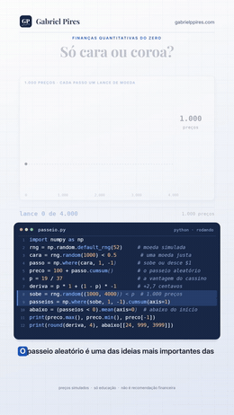

# O passeio aleatório

**Um gráfico de ações é mesmo só uma sequência de lances de moeda?**

Série *Finanças Quantitativas do Zero*

[](passeio-aleatorio.ipynb)
[](passeio-aleatorio_nota_tecnica.pdf)
[-Ibovespa_1995%E2%80%932026-1B7A4A)](#-o-teste-com-dado-real)
[](#-como-rodar)

Some lances de moeda e você tem um passeio aleatório. Dê à moeda uma pequena vantagem e ele ganha uma **deriva**. Esse é o modelo mais simples de um preço: **variação = deriva + passo aleatório**. A deriva é o retorno médio; os passos aleatórios são o risco. O vídeo mostra por que você quase não vê a deriva no curto prazo e por que ela decide o longo.

**[📓 Abrir o notebook](passeio-aleatorio.ipynb)** · **[📄 Ler a nota técnica](passeio-aleatorio_nota_tecnica.pdf)** · **[🎬 Ver no Instagram](https://instagram.com/gabrielp.piress)** · **[🗺️ O repositório](https://github.com/gabrielp18/financas-quant-do-zero)**

<br clear="right">

## ⚡ O episódio em 30 segundos

Uma moeda justa: cara, o preço sobe \$1; coroa, desce \$1. Some 1.000 lances a partir de \$100 e o preço **sobe até \$125, despenca até \$86 e bate uma nova máxima de \$131**. Parece tendência, queda e recuperação. A moeda nunca mudou.

Agora dê à moeda a vantagem do cassino: 19 em 37. Cada passo ganha **+2,7 centavos** de deriva. Deixe 1.000 preços andarem 4.000 passos:

| Depois de… | Preços abaixo do início |
|---|---|
| 25 passos | **43 %** |
| 1.000 passos | **20 %** |
| 4.000 passos | **4 %** |

A deriva cresce com $n$; a aleatoriedade, só com $\sqrt{n}$. **Depois de 1.368 passos, a deriva está na frente.**

## 🐍 O código da tela

As 12 linhas que aparecem digitadas no vídeo. O notebook começa exatamente por elas.

```python
import numpy as np
rng = np.random.default_rng(52)     # moeda simulada
cara = rng.random(1000) < 0.5        # uma moeda justa
passo = np.where(cara, 1, -1)       # sobe ou desce $1
preco = 100 + passo.cumsum()        # o passeio aleatório
p = 19 / 37                         # a vantagem do cassino
deriva = p * 1 + (1 - p) * -1       # +2,7 centavos
sobe = rng.random((1000, 4000)) < p  # 1.000 preços
passeios = np.where(sobe, 1, -1).cumsum(axis=1)
abaixo = (passeios < 0).mean(axis=0)  # abaixo do início
print(preco.max(), preco.min(), preco[-1])
print(round(deriva, 4), abaixo[[24, 999, 3999]])
```

```text
131 86 128
0.027 [0.426 0.204 0.042]
```

## 🎲 Os padrões que o acaso inventa

Quão raro é o passeio da tela numa moeda justa? O notebook simula 20.000 passeios justos de 1.000 lances:

| No passeio da tela | Numa moeda justa, acontece em… |
|---|---|
| 82,2 % do tempo acima de \$100 | 27,7 % dos passeios (lei do arco-seno) |
| máxima de +\$31 | 32,7 % (princípio da reflexão) |
| queda de \$39 do pico ao fundo | 42,5 % |
| 11 lances iguais seguidos | 38,9 % |

Meio a meio (40 % a 60 % do tempo acima do início) é o resultado **menos** provável: só 12,8 %. E a moeda justa da tela deu 514 caras em 1.000, ou 51,4 %, exatamente a frequência da moeda do cassino. Com 1.000 lances, não dá para distinguir as duas.

## 🎯 O teste com dado real

**O Ibovespa é um passeio aleatório?** O teste clássico é a razão de variâncias de **Lo & MacKinlay (1988)**: num passeio aleatório, a variância de um retorno de $q$ dias é $q$ vezes a de um dia, e $VR(q) = 1$. O artigo trouxe a estatística $z^*$, robusta às fases calmas e agitadas da bolsa.

Ibovespa diário e semanal, de 02/01/1995 a 16/10/2026:

| Retornos | $VR(2)$ | $VR(4)$ | $VR(8)$ | $VR(16)$ | Algum $z^*$ rejeita a 5 %? |
|---|---|---|---|---|---|
| Diários (7.861) | 1,005 | 0,981 | 0,878 | 0,906 | não |
| Semanais (1.659) | 0,904 | 0,948 | 0,988 | 0,908 | não |

**Não rejeita.** As razões ficam um pouco abaixo de 1, dentro do ruído. O teste ingênuo, sem a correção de Lo & MacKinlay, "rejeitaria" duas vezes ($z$ de −3,64 e −3,92). Lo & MacKinlay rejeitaram o passeio aleatório nos índices americanos de 1962 a 1985, com autocorrelação positiva; no Ibovespa de 1995 a 2026, não há tendência de curto prazo para explorar.

> O sinal do próximo dia não tem memória. O tamanho do movimento tem: a autocorrelação do retorno absoluto é 0,30 em 1 dia e ainda 0,10 em 60 dias.

E a deriva da bolsa? **Desde 1995, o Ibovespa rendeu menos que o CDI**: 12,9 % contra 15,0 % ao ano. Mas com 30,8 % de volatilidade, o intervalo de 95 % da deriva sobre o CDI vai de −11,8 % a +8,5 % ao ano. **Trinta anos de dados não dizem se a bolsa brasileira paga prêmio sobre o CDI.**

## 🗺️ O que tem no notebook

| Seção | O que você leva |
|:-:|---|
| 0 | O código da tela (`passeio.py`) e um `assert` para cada número do vídeo |
| 1 | Um lance, um passo: a deriva e o risco de um passo |
| 2 | Somar lances: média $n\mu$, desvio $\sigma\sqrt{n}$ |
| 3 | Os padrões são ilusão: arco-seno, reflexão e a maior sequência |
| 4 | A moeda com vantagem: 1.000 preços, 4.000 passos e a linha da deriva |
| 5 | Abaixo do início: binomial exata contra a normal |
| 6 | A corrida: por que a deriva passa na frente em 1.368 passos |
| 7 | A ruína do jogador: apostar pouco contra a casa é o pior |
| 8 | 🇧🇷 O Ibovespa é um passeio aleatório? Lo & MacKinlay (1988) |
| 9 | 💼 **Investidor:** Ibovespa contra o CDI como deriva + ruído |
| 10 | 🏦 **Mesa:** 52 % de acerto é habilidade ou sorte? |
| 11 | O que este modelo não vê + exercícios |

## 📐 As doze equações

As mesmas no notebook e na nota técnica. A nota continua a numeração até a (24), com as demonstrações.

| | Equação | O que ela diz |
|:-:|---|---|
| (1) | $\mu = 2p - 1$ | a deriva de um passo: +2,7¢ com $p$ = 19/37 |
| (2) | $\sigma^2 = 1 - \mu^2$ | o risco de um passo |
| (3) | $\mathbb{E}[S_n] = n\mu$, $\mathrm{DP}[S_n] = \sigma\sqrt{n}$ | a média cresce com $n$, o desvio com $\sqrt{n}$ |
| (4) | $\Pr(F_n \le x) \to \frac{2}{\pi}\arcsin\sqrt{x}$ | meio a meio é o menos provável |
| (5) | $\Pr(\max S \ge a) = \Pr(S_n \ge a) + \Pr(S_n > a)$ | o princípio da reflexão |
| (6) | $R_n / \log_2 n \to 1$ | a maior sequência cresce como o logaritmo |
| (7) | $\Pr(S_n < 0) \approx \Phi(-\mu\sqrt{n}/\sigma)$ | abaixo do início |
| (8) | $n^* = (\sigma/\mu)^2$, $n_z = (z\sigma/\mu)^2$ | a corrida: 1.368 e 3.701 passos |
| (9) | $(1 - r^a)/(1 - r^N)$ | a ruína do jogador |
| (10) | $VR(q) = 1 + 2\sum_k (1 - k/q)\rho_k$ | a razão de variâncias |
| (11) | $z^*(q) = \sqrt{nq}\,(VR - 1)/\sqrt{\hat\theta(q)}$ | o teste robusto de Lo & MacKinlay |
| (12) | $\Phi(-\mu\sqrt{T}/\sigma)$ | a chance de a bolsa perder do CDI em $T$ anos |

## 💸 Dois usos que valem dinheiro

**🏦 Na mesa.** Um operador acerta 52 % dos trades, com ganho ou perda de R\$ 1.000 em cada. Quantos trades até provar que é habilidade?

| Custo por trade | Trades para 95 % de confiança | Anos, a 1 trade por dia |
|---|---|---|
| R\$ 0 | 1.688 | 6,7 |
| R\$ 10 | 3.001 | 11,9 |
| R\$ 20 | 6.753 | 26,8 |

Depois de um ano (252 trades), um operador **sem habilidade nenhuma** mostra 52 % ou mais em 24,4 % das vezes. E com R\$ 20.000 de capital, o mesmo operador de 52 % quebra antes de dobrar em 46,0 % das vezes com trades de R\$ 10.000, e em 3,9 % com trades de R\$ 500.

**💼 Para o investidor.** R\$ 10.000 em 02/01/1995 viraram **R\$ 477.633 no Ibovespa e R\$ 843.621 no CDI** (antes de imposto e custos). A bolsa perdeu do CDI em 15 dos 31 anos-calendário. Se o prêmio sobre o CDI fosse de 5 % ao ano, a deriva levaria **38 anos** para empatar com um desvio do ruído, e **103 anos** para aparecer com 95 % de confiança.

## 📄 A nota técnica

16 páginas em A4 com oito proposições demonstradas. Três que costumam surpreender:

- 🎲 **Num passeio justo, ficar meio a meio acima e abaixo do início é o resultado menos provável.** A lei do arco-seno tem forma de U.
- 🎰 **Contra a casa, apostar pouco é o pior.** Para dobrar R\$ 100 no vermelho: uma aposta de R\$ 100 dá 48,6 %; cem de R\$ 1 dão 0,45 %.
- ⏳ **Observar a bolsa de minuto em minuto não ajuda a medir a deriva.** A precisão depende só do tempo de amostra (Merton, 1980), e no Ibovespa o erro-padrão é de 5,5 pontos ao ano em 31,8 anos.

**[📄 Baixar a nota técnica (PDF)](passeio-aleatorio_nota_tecnica.pdf)**

## 🧩 Teste você mesmo

<details>
<summary><b>1.</b> Uma moeda tem p = 0,55. Qual a deriva e o n*? Depois de 100 lances, qual a chance de estar abaixo do início?</summary>
<br>
Deriva de 0,10 e desvio de 0,9950 por passo; n* = 99,0. Pela normal, Φ(−1,005) = 15,7 %; a conta exata dá 13,5 %, porque com 100 lances o empate em zero não conta como "abaixo".
</details>

<details>
<summary><b>2.</b> Qual a chance de um passeio justo de 400 passos chegar a +40 em algum momento?</summary>
<br>
Pelo princípio da reflexão, P(S ≥ 40) + P(S > 40) = 4,6 %.
</details>

<details>
<summary><b>3.</b> Na roleta americana (o vermelho ganha com 18/38), com R&#36; 100 e apostas de R&#36; 10, qual a chance de dobrar a banca?</summary>
<br>
25,9 %. Na roleta europeia, 36,8 %. Um zero a mais na roda tira 11 pontos.
</details>

<details>
<summary><b>4.</b> Uma estratégia tem Sharpe de 0,5 ao ano. Quantos anos para o resultado aparecer com 95 % de confiança?</summary>
<br>
(1,645 / 0,5)² = 10,8 anos.
</details>

<details>
<summary><b>5.</b> O VR(2) diário de um ativo é 1,10. Qual a autocorrelação de primeira ordem?</summary>
<br>
VR(2) = 1 + ρ₁, logo ρ₁ = 0,10.
</details>

## 🚀 Como rodar

Na sua máquina, com Python 3:

```bash
pip install numpy pandas matplotlib jupyterlab
jupyter lab passeio-aleatorio.ipynb      # de dentro desta pasta
```

No Google Colab, rode isto numa célula antes (o notebook lê os dados da pasta `dados/`):

```python
!git clone -q https://github.com/gabrielp18/financas-quant-do-zero.git
%cd financas-quant-do-zero/codigos/01_passeio_aleatorio
```

## 📂 Nesta pasta

| Arquivo | O que é |
|---|---|
| [`passeio-aleatorio.ipynb`](passeio-aleatorio.ipynb) | o notebook, executado, com 9 gráficos e um `assert` para cada número do vídeo |
| [`passeio-aleatorio_nota_tecnica.pdf`](passeio-aleatorio_nota_tecnica.pdf) | a nota técnica: demonstrações, tabelas, exercícios e referências |
| [`dados/ibovespa.csv`](dados/ibovespa.csv) | fechamento diário do Ibovespa (`^BVSP`, Yahoo Finance), de 02/01/1995 a 16/10/2026 |
| [`dados/cdi_diario.csv`](dados/cdi_diario.csv) | CDI em % ao dia útil, série 12 do SGS ([Banco Central](https://www3.bcb.gov.br/sgspub/)), de 02/01/1995 a 16/10/2026 |
| `img/abertura.gif` | a abertura do vídeo, aí em cima |

---

<sub>O vídeo é inspirado em *Quant Finance from Scratch*, de [@quantfinancetogo](https://instagram.com/quantfinancetogo). Preços simulados nas seções 0 a 7 do notebook; dados reais do Ibovespa e do CDI nas seções 8 e 9. Só educação, não é recomendação de investimento. Feito por [Gabriel Pires](https://gabrielppires.com) · [@gabrielp.piress](https://instagram.com/gabrielp.piress)</sub>
