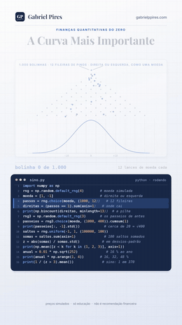

# A curva de sino

**Por que passos aleatórios sempre formam o mesmo sino? E o que ele diz sobre até onde uma ação pode ir?**

*Finanças Quantitativas do Zero*

[](curva-normal.ipynb)
[](curva-normal_nota_tecnica.pdf)
[](#-o-teste-que-ninguém-pediu)
[](#-como-rodar)

Some muitos passos aleatórios pequenos e sai sempre a mesma forma. **É a curva mais importante da teoria das finanças quantitativas**, e também a mais mal usada: ela acerta o ano e erra o dia.

**[📓 Abrir o notebook](curva-normal.ipynb)** · **[📄 Ler a nota técnica](curva-normal_nota_tecnica.pdf)** · **[🎬 Ver no Instagram](https://instagram.com/gabrielp.piress)** · **[🗺️ Todos os vídeos](https://github.com/gabrielp18/financas-quant-do-zero)**

<br clear="right">

## ⚡ O episódio em 30 segundos

Solte 1.000 bolinhas numa tábua com 12 fileiras de pinos. Em cada pino, direita ou esquerda, como uma moeda. São 4.096 caminhos, todos igualmente prováveis, mas só 1 vai sempre à direita, enquanto **924 vão à direita exatamente 6 vezes** e caem no meio. Resultado: 613 das 1.000 bolinhas nas 3 casas do meio.

Troque a moeda por qualquer passo, some 100 deles, e o mesmo sino aparece: é o **teorema central do limite**. E o sino tem uma regra simples:

| Dentro de… | Do sino | Das 100.000 somas do vídeo |
|---|---|---|
| ±1 desvio-padrão | 68,27 % | 68,2 % |
| ±2 desvios | 95,45 % | 95,5 % |
| ±3 desvios | 99,73 % | 99,7 % |

**Uma ação que oscila 1 % ao dia oscila 1 % × √252 = 15,9 % ao ano.** Pelo sino, ela termina o ano dentro de ±16 % em 2 anos a cada 3, dentro de ±32 % em 19 a cada 20, e passa de ±48 % uma vez a cada 370 anos.

## 🐍 O código da tela

As 16 linhas que aparecem digitadas no vídeo. O notebook começa exatamente por elas.

```python
import numpy as np
rng = np.random.default_rng(4)        # moeda simulada
moeda = [1, -1]                       # direita ou esquerda
passos = rng.choice(moeda, (1000, 12))   # 12 fileiras
direitas = (passos == 1).sum(axis=1)   # onde cai
print(np.bincount(direitas, minlength=13))  # a pilha
rng3 = np.random.default_rng(3)       # os passeios de antes
passeios = rng3.choice(moeda, (1000, 400)).cumsum(1)
print(passeios[:, -1].std())            # cerca de 20 = √400
saltos = rng.uniform(-1, 1, (100000, 100))
somas = saltos.sum(axis=1)              # 100 saltos somados
z = abs(somas) / somas.std()           # em desvios-padrão
print(np.mean([z < k for k in (1, 2, 3)], axis=1))
anual = 0.01 * np.sqrt(252)              # 16 % ao ano
print(anual * np.arange(1, 4))        # 16, 32, 48 %
print(1 / (z > 3).mean())              # sino: 1 em 370
```

```text
[  1   2  15  52 118 167 246 200 130  49  18   2   0]
19.91819580182904
[0.68178 0.95463 0.99723]
[0.15874508 0.31749016 0.47623524]
361.01083032490976
```

> A última linha dá **361**, não 370. Não é erro: a soma de 100 uniformes tem a cauda um pouco mais fina que o sino. A conta exata (Irwin–Hall, com 250 algarismos) dá 1 em 381,7, e a simulação teve 277 somas além de 3 desvios onde se esperavam 262 ± 16.

## 🎯 O teste que ninguém pediu

O vídeo termina com um porém: *retornos reais têm caudas gordas*. Quão gordas? O teste é a tabela de **Fama (1965)**, que comparou as ações do Dow Jones com o sino contando dias dentro de cada faixa de desvios. Com o **Ibovespa, 7.862 dias de 1995 a 2026**:

| Além de… | O sino espera | O Ibovespa teve |
|---|---|---|
| 3 desvios | 21,2 dias | **113** |
| 4 desvios | 0,5 dia | **53** |
| 5 desvios | 0,0045 dia | **27** |
| 6 desvios | 0,000016 dia | **14** |

Três descobertas:

1. 📉 **Metade da cauda gorda é volatilidade que muda.** Medindo cada dia contra a volatilidade da véspera, a curtose cai de 15,4 para 2,0. A conta fecha: a vol que muda, sozinha, explica 7,6; junto com a cauda que sobra, 14,8, contra 15,1 medida.
2. 🐘 **A cauda segue uma lei de potência com expoente perto de 3.** Hill dá 2,65 a 3,10; a *t* de Student ajustada, ν = 3,48. Contra Mandelbrot (1963), a variância existe. A favor dele, a curtose não: cada crise nova a muda de lugar.
3. ⚡ **O maior choque não foi a covid: foi o Joesley Day.** Em 18/05/2017, o Ibovespa caiu 8,8 %, só 4,7 desvios da amostra inteira, mas **8,1 desvios** da volatilidade da véspera, porque o mercado estava calmo.

> No ano, o sino volta: a curtose do retorno anual é 0,21, e 24 dos 31 anos ficaram dentro de ±1σ. O sino é um modelo ruim para o dia e razoável para o ano.

## 🗺️ O que tem no notebook

| Seção | O que você leva |
|:-:|---|
| 0 | O código da tela (`sino.py`), linha por linha |
| 1 | A tábua de Galton: 4.096 caminhos, 924 no meio |
| 2 | Do binômio ao sino (De Moivre–Laplace) e a raiz quadrada |
| 3 | O teorema central do limite: passos de qualquer forma, e a velocidade |
| 4 | A regra 68–95–99,7, o "1 em 370" e a garantia de Chebyshev |
| 5 | Uma ação a 1 % ao dia: a raiz do tempo e a grade da moeda |
| 6 | Caudas gordas simuladas: a *t* de Student |
| 7 | 🇧🇷 Ibovespa desde 1995 contra o sino: a tabela de Fama (1965) |
| 8 | 🇧🇷 Quanto da cauda é volatilidade que muda (EWMA) |
| 9 | Mandelbrot (1963): a *t* por máxima verossimilhança e o índice de cauda de Hill |
| 10 | O teorema central do limite no tempo: diário, semanal, mensal, anual |
| 11 | 💰 **Investidor:** o dia de "1 em 370" e a regra dos 2 anos em 3 |
| 12 | 🏦 **Mesa:** VaR de 99 % em BOVA11 e o backtest de Kupiec |
| 13 | O que o sino não vê + exercícios |

## 📐 As doze equações

As mesmas no notebook e na nota técnica. A nota continua a numeração até a (28), com as demonstrações.

| | Equação | O que ela diz |
|:-:|---|---|
| (1) | $P(K=k) = \binom{n}{k}/2^n$ | o meio tem mais caminhos |
| (2) | $P(K=k) \approx \frac{1}{\sqrt{2\pi n/4}}\,e^{-(k-n/2)^2/(n/2)}$ | De Moivre: o binômio vira sino |
| (3) | $\mathrm{dp}(S_n) = \sqrt{n}$ | a regra da raiz quadrada |
| (4) | $(S_n - n\mu)/(\sigma\sqrt{n}) \to N(0,1)$ | o teorema central do limite |
| (5) | $P(\lvert Z\rvert \le k) = \mathrm{erf}(k/\sqrt{2})$ | 68,27 · 95,45 · 99,73 % |
| (6) | $P(\lvert X-\mu\rvert \ge k\sigma) \le 1/k^2$ | Chebyshev: a garantia sem supor nada |
| (7) | $\sigma_T = \sigma_1\sqrt{T}$ | 1 % ao dia = 15,9 % ao ano |
| (8) | $t$ de Student: variância $\nu/(\nu-2)$, curtose $6/(\nu-4)$ | a cauda gorda de livro-texto |
| (9) | $\sigma_t^2 = \lambda\sigma_{t-1}^2 + (1-\lambda)r_{t-1}^2$ | a volatilidade do momento (RiskMetrics) |
| (10) | $\hat\alpha_k = \big[\frac{1}{k}\sum \ln(X_{(i)}/X_{(k+1)})\big]^{-1}$ | Hill: o expoente da cauda |
| (11) | $\mathrm{VaR}_{99\%} = V\,\hat\sigma\,q_{0,99}$ | o VaR de mesa |
| (12) | $LR \sim \chi^2_1$ | Kupiec: o VaR passou no backtest? |

## 💸 Dois usos que valem dinheiro

**🏦 Na mesa.** R\$ 1 milhão em BOVA11, VaR de 99 % de um dia, backtest de 2010 a 16/10/2026 (4.161 pregões, 41,6 violações esperadas):

| Método | Violações | Kupiec (p-valor) | VaR médio |
|---|---|---|---|
| Sino, 252 dias | 56 | 0,033 ❌ | R\$ 32.684 |
| *t* de Student (ν = 3,69, estimado antes do teste) | 31 | 0,083 | R\$ 37.337 |
| Histórico, 252 dias | 54 | 0,065 | R\$ 35.837 |
| Sino com EWMA | 65 | 0,001 ❌ | R\$ 30.883 |

Quando o VaR do sino estoura, estoura por muito: em 12/03/2020, a perda foi de **R\$ 147.797, 3,9 vezes o VaR**. É por isso que a regulação trocou o VaR pelo *expected shortfall*.

**💰 Na carteira.** "Um dia de 1 em 370" quer dizer um dia a cada ano e meio: 21 em 31 anos. O Ibovespa teve 113, e 90 deles caíram em só cinco anos: 1995, 1997, 1998, 2008 e 2020. Com R\$ 100 mil em BOVA11 hoje, um dia de 3 desvios é uma variação de R\$ 3.611 a R\$ 5.184. **No ano, a regra do vídeo funciona**: 24 dos 31 anos civis ficaram dentro de ±1σ e 29 dentro de ±2σ.

## 📄 A nota técnica

16 páginas em A4 com dez proposições demonstradas. Três que costumam surpreender:

- 🎲 **O "361" da tela é a resposta certa.** A soma de 100 uniformes tem a cauda mais fina que o sino: 1 em 381,7, pela conta exata e pela correção de Edgeworth, não 1 em 370.
- 🪙 **"2 anos em 3" deu 66,2 % na simulação por causa da grade da moeda.** Com passos de ±1 %, o ano é um número par de por cento; a binomial exata e o sino com correção de continuidade dão 65,53 %.
- ⚖️ **O *expected shortfall* de 97,5 % é quase igual ao VaR de 99 % no sino (2,338σ contra 2,326σ).** A troca regulatória não muda o capital de quem é normal, e cobra mais de quem tem cauda gorda (2,857σ contra 2,658σ numa *t* com ν = 3,69).

**[📄 Baixar a nota técnica (PDF)](curva-normal_nota_tecnica.pdf)**

## 🧩 Teste você mesmo

<details>
<summary><b>1.</b> Pelo sino, qual a chance de um resultado além de 2,5 desvios?</summary>
<br>
1,24 %, ou 1 em 81. A razão de Mills, φ(k)/k, dá a ordem de grandeza de cabeça: entre 1,18 % e 1,40 %.
</details>

<details>
<summary><b>2.</b> Uma ação oscila 2 % ao dia. Qual a oscilação anual?</summary>
<br>
2 % × √252 = 31,7 % ao ano. Em 19 anos a cada 20, ela termina entre −63,5 % e +63,5 %.
</details>

<details>
<summary><b>3.</b> Sem saber a distribuição, quanto, no mínimo, fica dentro de 4 desvios?</summary>
<br>
Pela desigualdade de Chebyshev, pelo menos 1 − 1/16 = 93,75 %. No sino, 99,9937 %.
</details>

<details>
<summary><b>4.</b> Qual a curtose em excesso de uma t de Student com 5 graus de liberdade? E com 4?</summary>
<br>
6/(ν − 4): 6 com ν = 5, e infinita com ν = 4 (o quarto momento não existe).
</details>

<details>
<summary><b>5.</b> VaR de 99 % de um dia para R&#36; 1 milhão com desvio de 1,5 % ao dia?</summary>
<br>
Pelo sino, 1.000.000 × 1,5 % × 2,326 = R&#36; 34.895. Por uma t com 4 graus de liberdade (com a variância corrigida), R&#36; 39.742.
</details>

## 🚀 Como rodar

Na sua máquina, da pasta deste episódio:

```bash
pip install numpy pandas matplotlib scipy jupyterlab
jupyter lab curva-normal.ipynb
```

No Google Colab, rode isto numa célula antes (o notebook lê os dados da pasta `dados/`):

```python
!git clone -q https://github.com/gabrielp18/financas-quant-do-zero.git
%cd financas-quant-do-zero/codigos/02_curva_normal
```

O `scipy` entra só no ajuste da *t* de Student por máxima verossimilhança (`scipy.optimize`).

## 📂 Nesta pasta

| Arquivo | O que é |
|---|---|
| [`curva-normal.ipynb`](curva-normal.ipynb) | o notebook, executado, com 10 gráficos e um `assert` para cada número do vídeo |
| [`curva-normal_nota_tecnica.pdf`](curva-normal_nota_tecnica.pdf) | a nota técnica: demonstrações, tabelas, exercícios e referências |
| [`dados/ibovespa.csv`](dados/ibovespa.csv) | fechamento diário do Ibovespa (^BVSP, Yahoo Finance), de 01/12/1994 a 16/10/2026 |
| [`dados/bova11.csv`](dados/bova11.csv) | fechamento diário do BOVA11 (Yahoo Finance), de 28/11/2008 a 16/10/2026 |
| `img/abertura.gif` | a abertura do vídeo, aí em cima |

---

<sub>O vídeo é inspirado em *Quant Finance from Scratch*, de [@quantfinancetogo](https://instagram.com/quantfinancetogo). Simulação nas seções 0 a 6 do notebook; dados reais do Ibovespa e do BOVA11 nas seções 7 a 12. Só educação, não é recomendação de investimento. Feito por [Gabriel Pires](https://gabrielppires.com) · [@gabrielp.piress](https://instagram.com/gabrielp.piress)</sub>
