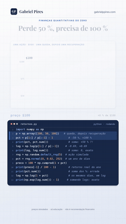

# Retornos

**Por que uma queda dói mais do que a mesma alta ajuda? E como os quants medem retornos de um jeito que se soma?**

Série *Finanças Quantitativas do Zero*

[](retornos-log.ipynb)
[](retornos-log_nota_tecnica.pdf)
[-38_a%C3%A7%C3%B5es_da_B3-1B7A4A)](#-o-teste-que-ninguém-pediu)
[](#-como-rodar)

Perca 50 % e você precisa de 100 % só para empatar. **Variações em porcentagem multiplicam; retornos log somam.** Parece detalhe de planilha, mas é o que separa o retorno que um fundo anuncia do que vai para o seu bolso, o P&L certo do errado e a posição alavancada que sobrevive da que não sobrevive.

**[📓 Abrir o notebook](retornos-log.ipynb)** · **[📄 Ler a nota técnica](retornos-log_nota_tecnica.pdf)** · **[🎬 Ver no Instagram](https://instagram.com/gabrielp.piress)** · **[🗺️ Todos os vídeos](https://github.com/gabrielp18/financas-quant-do-zero)**

<br clear="right">

## ⚡ O episódio em 30 segundos

Uma ação sai de \$100, cai para \$50 e volta para \$100. Em porcentagem: −50 % e depois +100 %. Some os dois e o papel diz **+50 %**, mas você está exatamente onde começou. Variações em % se medem a partir de onde você está, e por isso **multiplicam**: × ½ e depois × 2.

O retorno log, $\ln(P_{novo}/P_{antigo})$, conserta isso: a queda vira −0,69, a alta vira +0,69, e juntas dão **exatamente zero**.

| Um ano simulado (252 dias, 2 % ao dia, semente 5) | Resultado |
|---|---|
| Somando os 252 retornos em % | −24,0 % |
| O que a ação realmente fez | **−25,0 %** |
| Somando os 252 retornos log e convertendo de volta | **−25,0 %**, exato |

## 🐍 O código da tela

As 13 linhas que aparecem digitadas no vídeo. O notebook começa exatamente por elas.

```python
import numpy as np
p = np.array([100, 50, 100])   # queda, depois recuperação
pct = p[1:] / p[:-1] - 1          # -50 %, +100 %
print(pct, pct.sum())             # soma: +50 % ?!
log = np.log(p[1:] / p[:-1])    # -0.69, +0.69
print(log, log.sum())             # soma: 0, exato
rng = np.random.default_rng(5)  # ação simulada
pct = rng.normal(0, 0.02, 252)  # um ano de dias
preco = 100 * np.cumprod(1 + pct)
print(preco[-1] / 100 - 1)        # retorno real do ano
print(pct.sum())                  # soma dos %: errada
log = np.log(1 + pct)             # os mesmos dias, em log
print(np.exp(log.sum()) - 1)     # somando logs: exato
```

```text
[-0.5  1. ] 0.5
[-0.69314718  0.69314718] 0.0
-0.2501051148297655
-0.23957590108940638
-0.2501051148297653
```

## 🎯 O teste que ninguém pediu

**1. O Ibovespa, ano a ano, desde 1995.** A mesma conta do vídeo com o índice de verdade (7.876 fechamentos, de 29/12/1994 a 16/10/2026). Somar os logs diários e converter reproduz o retorno de **todos os 32 anos**. Somar os % diários erra, e erra **para os dois lados**:

| Ano | Soma dos % diários | Retorno de verdade | Por quê |
|---|---|---|---|
| 1995 | +14,7 % | **−1,3 %** | vol de 58 % sem tendência: o arrasto ganha |
| 2008 | −39,6 % | **−41,2 %** | crise: 13,5 pontos de arrasto |
| 2020 | +12,8 % | **+2,9 %** | vol de 45 %: 10 pontos de arrasto |
| 1999 | +103,6 % | **+151,9 %** | tendência maior que a vol: a composição ganha |

A lacuna entre a soma dos % e a soma dos logs é $\tfrac12\sum R^2$, o **arrasto da volatilidade** (correlação de 0,9991 nos 32 anos).

**2. Replicação de Hudson & Gregoriou (2015).** O artigo mostra que a média dos retornos log fica abaixo da média dos simples por cerca de $s^2/2$, e que isso muda a **comparação** entre ativos. Nas 38 ações da B3 (dados diários de 2015 a 09/10/2026):

- 📏 diferença das médias contra $s^2/2$: inclinação **0,987** (IC 95 % por bootstrap em blocos: 0,963 a 1,005);
- 🔀 **34 das 38** ações mudam de posição no ranking, e 101 dos 703 pares invertem a ordem;
- 🎢 MGLU3 é a **2ª** maior média simples e só a **13ª** em log; CSNA3 cai da 13ª para a 33ª; TAEE11 sobe da 20ª para a 9ª;
- 🕳️ BRKM5 teve **média diária positiva e perdeu 60 %** no período.

> Quem ordena ativos pela média aritmética de retornos diários está, sem perceber, premiando volatilidade.

## 🗺️ O que tem no notebook

| Seção | O que você leva |
|:-:|---|
| 0 | O código da tela (`retornos.py`), linha por linha, com um `assert` para cada número do vídeo |
| 1 | Um retorno é medido de onde você começa: a tabela de recuperação |
| 2 | O retorno log e a escala log: cada metade é o mesmo passo |
| 3 | Somar no tempo: o ano simulado, −24 % no papel e −25 % de verdade |
| 4 | Por que a soma dos % erra, e para que lado (Taylor) |
| 5 | Dias pequenos, dias grandes: +1 % é 0,00995, e −100 % é −∞ |
| 6 | Por que os quants amam o log: o preço nunca fica negativo, e é lognormal |
| 7 | Entre ativos, quem soma é o retorno simples |
| 8 | 🇧🇷 O Ibovespa ano a ano desde 1995 |
| 9 | 🔬 **Replicação:** Hudson & Gregoriou (2015) em 38 ações da B3 |
| 10 | 🏦 **Mesa:** P&L de um long-short em R\$ e a posição alavancada |
| 11 | 💰 **Investidor:** a "média de 1 % ao mês", o CDI de cada dia e o tempo para voltar ao topo |
| 12 | O que este modelo não vê + exercícios |

## 📐 As nove equações

As mesmas no notebook e na nota técnica. A nota continua a numeração até a (22), com as demonstrações.

| | Equação | O que ela diz |
|:-:|---|---|
| (1) | $R_t = P_t/P_{t-1} - 1$ | retorno simples |
| (2) | $1 + R_{0\to T} = \prod_t (1+R_t)$ | variações em % multiplicam |
| (3) | $R^\ast = -R/(1+R)$ | a alta que desfaz a queda: −50 % pede +100 % |
| (4) | $r_t = \ln(1+R_t)$ | retorno log |
| (5) | $r_{0\to T} = \sum_t r_t$ | retornos log somam no tempo |
| (6) | $\sum r_t \approx \sum R_t - \tfrac12\sum R_t^2$ | o arrasto da volatilidade |
| (7) | $\mathbb{E}[P_T] = P_0\,e^{mT + s^2T/2}$, mediana $P_0\,e^{mT}$ | o preço lognormal |
| (8) | $R_p = \sum_i w_i R_i$ | entre ativos, quem soma é o simples |
| (9) | $\bar r \approx \bar R - s^2/2$ | Hudson & Gregoriou |

## 💸 Dois usos que valem dinheiro

**🏦 Na mesa.** Comprado em R\$ 10 milhões de ITUB4 e vendido em R\$ 10 milhões de BBDC4, de 30/12/2025 a 09/10/2026: o P&L, perna a perna em retorno simples, é **R\$ 721.460**. Pela diferença dos logs daria R\$ 564.509, um erro de R\$ 156.951. E a posição **2× no Ibovespa, rebalanceada todo dia**, em 2020:

| | 2020 |
|---|---|
| Ibovespa | +2,9 % |
| 2× rebalanceado todo dia | **−16,8 %** |

O arrasto cresce com $L(L-1)$, quase o quadrado da alavancagem. Com 7× no dia 10/09/1998, a posição perdeu 111,3 %: mais que o capital, e o retorno log deixa de existir.

**💰 No bolso.** O Ibovespa de 1995 a 2026 teve "média" de **1,34 % ao mês**, mas rendeu **1,01 % ao mês** composto. Desconfie de fundo que anuncia média:

| Fundo com média aritmética de 1 % ao mês e desvio mensal de… | Rende, composto, em 12 meses |
|---|---|
| 0 % | 12,7 % |
| 5 % | 11,0 % |
| 8 % | 8,5 % |

E o CDI se acumula multiplicando os fatores diários: nos 12 meses até 16/10/2026, **14,36 %**. Somar as taxas diárias daria 13,42 %, que é a taxa contínua, $\ln 1{,}1436$.

## 📄 A nota técnica

16 páginas em A4 com dez proposições demonstradas. Três que costumam surpreender:

- ↕️ **A soma dos % erra para os dois lados, e dá para saber qual.** Ela exagera quando a tendência do período é menor que a volatilidade realizada, e subestima quando é maior. A regra acerta o lado em 30 dos 32 anos do Ibovespa.
- 📉 **Contra o CDI, o Ibovespa nunca voltou ao topo de julho de 1997.** Medido em CDIs, ele chegou a ficar 81,1 % abaixo (janeiro de 2016) e ainda está 61,5 % abaixo. Com logs, essa conta é uma subtração.
- 🎲 **Numa ação sem tendência, o preço esperado é \$100, mas o ano típico termina em \$95.** A média e a mediana se separam pelo arrasto, e o ano do vídeo (−25 %) acontece em mais de 1 ano a cada 5.

**[📄 Baixar a nota técnica (PDF)](retornos-log_nota_tecnica.pdf)**

## 🧩 Teste você mesmo

<details>
<summary><b>1.</b> Uma ação cai 20 % num dia e sobe 20 % no seguinte. Onde termina? Quanto precisava ter subido?</summary>
<br>
0,8 × 1,2 − 1 = −4,0 %. Para voltar: 1/0,8 − 1 = +25,0 %.
</details>

<details>
<summary><b>2.</b> Os retornos log de uma semana foram +0,02, −0,03, +0,01, +0,04 e −0,01. Qual o retorno da semana em %?</summary>
<br>
Some os logs: 0,03. Converta: e^0,03 − 1 = +3,05 %.
</details>

<details>
<summary><b>3.</b> Carteira com 60 % na ação A (+30 % no ano) e 40 % na B (−10 %). Qual o retorno?</summary>
<br>
0,6 × 30 % + 0,4 × (−10 %) = +14,0 %. A média ponderada dos logs, convertida, daria +12,22 %: errado, porque entre ativos quem soma é o simples.
</details>

<details>
<summary><b>4.</b> Um fundo divulga "média de 2 % ao mês", com desvio mensal de 10 %. Quanto rende de verdade?</summary>
<br>
Cerca de 2 % − 0,10²/2 = 1,5 % ao mês, ou 19,6 % em 12 meses, e não os 26,8 % de 1,02¹² − 1.
</details>

<details>
<summary><b>5.</b> O CDI está em 14,15 % ao ano. Quanto dá somar as 252 taxas diárias?</summary>
<br>
A taxa diária é 1,1415^(1/252) − 1 = 0,05253 %. Somando 252, 13,24 %: é a taxa contínua, ln 1,1415 = 13,23 %, e não os 14,15 %.
</details>

## 🚀 Como rodar

Na sua máquina:

```bash
pip install numpy pandas matplotlib jupyterlab
jupyter lab retornos-log.ipynb       # de dentro desta pasta
```

No Google Colab, rode isto numa célula antes (o notebook lê os dados da pasta `dados/`):

```python
!git clone -q https://github.com/gabrielp18/financas-quant-do-zero.git
%cd financas-quant-do-zero/codigos/03_retornos_log
```

## 📂 Nesta pasta

| Arquivo | O que é |
|---|---|
| [`retornos-log.ipynb`](retornos-log.ipynb) | o notebook, executado, com 10 gráficos e 31 `assert` (52 conferências) |
| [`retornos-log_nota_tecnica.pdf`](retornos-log_nota_tecnica.pdf) | a nota técnica: demonstrações, tabelas, exercícios e referências |
| [`dados/ibovespa.csv`](dados/ibovespa.csv) | fechamento diário do Ibovespa (`^BVSP`, Yahoo Finance), de 29/12/1994 a 16/10/2026 |
| [`dados/cdi_diario.csv`](dados/cdi_diario.csv) | CDI em % ao dia útil, série 12 do SGS do [Banco Central](https://www3.bcb.gov.br/sgspub/), de 02/01/1995 a 16/10/2026 |
| [`dados/acoes_b3.csv`](dados/acoes_b3.csv) | 38 ações da B3 e o Ibovespa, preços ajustados por proventos (Yahoo Finance), de 02/01/2015 a 09/10/2026 |
| `img/abertura.gif` | a abertura do vídeo, aí em cima |

---

<sub>O vídeo é inspirado em *Quant Finance from Scratch*, de [@quantfinancetogo](https://instagram.com/quantfinancetogo). Preços simulados nas seções 0 a 7 do notebook; dados reais do Ibovespa, do CDI e de 38 ações da B3 nas seções 8 a 12. Só educação, não é recomendação de investimento. Feito por [Gabriel Pires](https://gabrielppires.com) · [@gabrielp.piress](https://instagram.com/gabrielp.piress)</sub>
