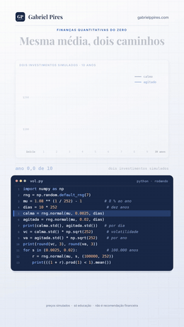

# Volatilidade

**Duas ações com a mesma média de 8 % ao ano. Por que uma perde dinheiro em 2,7 % dos anos e a outra em 46,8 %?**

*Finanças Quantitativas do Zero*

[](volatilidade.ipynb)
[](volatilidade_nota_tecnica.pdf)
[](#-o-teste-que-ninguém-pediu)
[](#-como-rodar)

Os quants falam de risco o tempo todo. **Risco é até onde os retornos oscilam em torno da média**, e a volatilidade mede isso: o desvio-padrão dos retornos, convertido num número anual. Parece pouco. Mas com a mesma média, a vol decide se você perde dinheiro em menos de 3 anos a cada 100 ou em quase um a cada dois.

**[📓 Abrir o notebook](volatilidade.ipynb)** · **[📄 Ler a nota técnica](volatilidade_nota_tecnica.pdf)** · **[🎬 Ver no Instagram](https://instagram.com/gabrielp.piress)** · **[🗺️ Todos os vídeos](https://github.com/gabrielp18/financas-quant-do-zero)**

<br clear="right">

## ⚡ O vídeo em 30 segundos

Dois investimentos simulados, os dois feitos para render 8 % ao ano em média. Um anda calmo, o outro oscila muito. Pegue os retornos diários, calcule o desvio-padrão e multiplique pela raiz quadrada de 252 pregões (15,87). Depois, simule 100.000 anos de cada um.

| | Calmo | Agitado |
|---|---|---|
| Desvio por dia | 0,25 % | 1,99 % |
| **Volatilidade** (× √252) | **3,9 % ao ano** | **31,6 % ao ano** |
| Anos dentro de 8 % ± vol ("2 em 3") | 64,1 % | 65,8 % |
| Anos de perda | 2,7 % | **46,8 %** |
| Ano mediano, pela lognormal (a média é 8 % nos dois) | 7,9 % | 2,7 % |

**Mesma média, destinos opostos.** O agitado tem ano mediano de 2,7 %: a média de 8 % é puxada por poucos anos enormes, e ele ainda termina no prejuízo em 39,6 % das décadas.

## 🐍 O código da tela

As 13 linhas que aparecem digitadas no vídeo. O notebook começa exatamente por elas.

```python
import numpy as np
rng = np.random.default_rng(7)
mu = 1.08 ** (1 / 252) - 1          # 8 % ao ano
dias = 10 * 252                      # dez anos
calma = rng.normal(mu, 0.0025, dias)
agitada = rng.normal(mu, 0.02, dias)
print(calma.std(), agitada.std())   # por dia
vc = calma.std() * np.sqrt(252)      # volatilidade
va = agitada.std() * np.sqrt(252)    # por ano
print(round(vc, 3), round(va, 3))
for s in (0.0025, 0.02):             # 100.000 anos
    r = rng.normal(mu, s, (100000, 252))
    print(((1 + r).prod(1) < 1).mean())
```

```text
0.0024745672282273194 0.019897771845882005
0.039 0.316
0.02736
0.4684
```

## 🎯 O teste que ninguém pediu

O vídeo trata a vol como um número fixo. No Ibovespa, ela foi de 12,9 % (2024) a 57,5 % (1998), com picos em 1998–99, 2008 e 2020. Em 1996, o documento técnico do **RiskMetrics** (J.P. Morgan/Reuters) propôs acompanhar a vol com uma média que esquece devagar, a EWMA, com $\lambda = 0{,}94$ para dados diários:

$$
\sigma^2_{t+1} = \lambda\,\sigma^2_t + (1-\lambda)\,r_t^2
$$

A pergunta: 30 anos depois, no Ibovespa de 1995 a 2026, essa regra prevê a vol do mês seguinte melhor que as alternativas? E 0,94 é o melhor $\lambda$ no Brasil?

| Previsão da variância dos 21 pregões seguintes | Erro quadrático (÷ média longa) | QLIKE |
|---|---|---|
| EWMA, $\lambda$ = 0,94 | 0,909 | **0,277** |
| EWMA, $\lambda$ = 0,97 | **0,832** | 0,288 |
| Janela de 21 pregões | 1,108 | 0,309 |
| Janela de 252 pregões | 0,910 | 0,384 |
| Média longa desde 1995 | 1,000 | 0,532 |

1. 🏆 **Pela QLIKE, a EWMA com 0,94 ganha de todas**, e a vantagem sobre a janela de um ano é significativa (bootstrap em blocos).
2. 🇧🇷 **O melhor $\lambda$ de um dia no Brasil é 0,935** pela QLIKE, entre 0,925 e 0,940 em cada década. O 0,94 sobrevive.
3. ⚠️ **Pelo erro quadrático, o critério do próprio documento, o ótimo é 0,870**, mas a curva é plana (usar 0,94 custa 0,67 % de erro) e refém de dias extremos: sem o 15/01/1999, vira 0,900; em 2016–2026, março de 2020 o leva para 0,70.
4. 📉 **A janela de 21 pregões é pior que não prever nada** (a média longa): reage a tudo e esquece rápido demais.

> E a regra da raiz quadrada? No Ibovespa, a vol medida com retornos semanais (30,4 %), mensais (30,0 %) e anuais (26,8 %) fica abaixo da regra da raiz sobre os diários (31,1 %). Sinal de reversão, mas nenhum intervalo de 95 % exclui a regra.

## 🗺️ O que tem no notebook

| Seção | O que você leva |
|:-:|---|
| 0 | O código da tela (`vol.py`), com um `assert` para cada número do vídeo |
| 1 | Risco é oscilação: o desvio-padrão |
| 2 | Do dia para o ano: a regra da raiz quadrada, e quando ela falha |
| 3 | "2 em 3": por que o vídeo dá 64,1 % e não os 68,3 % da curva de sino |
| 4 | Anos de perda: por que 46,8 % e não 40 %; média × mediana; e se eu esperar? |
| 5 | Quanto dado é preciso para saber a vol, e por que a média é muito pior |
| 6 | 🇧🇷 Ibovespa desde 1995: a vol ano a ano, o "2 em 3" de verdade, o teste da raiz e o erro da vol |
| 7 | 🇧🇷 A vol muda com o tempo: EWMA e a replicação do RiskMetrics (1996) |
| 8 | 💼 **Investidor:** 38 ações, o CDI, o dólar e o ano ruim "1 em 6" |
| 9 | 🏦 **Mesa:** P&L de um desvio, VaR e vol-alvo de 10 % em BOVA11 |
| 10 | O que a volatilidade não vê + exercícios |

## 📐 As oito equações

As mesmas no notebook e na nota técnica. A nota continua a numeração até a (19), com as demonstrações.

| | Equação | O que ela diz |
|:-:|---|---|
| (1) | $\sigma = \sqrt{\frac1n\sum (r_i - \bar r)^2}$ | risco é a distância típica até a média |
| (2) | $\sigma_{\text{ano}} = \sigma_{\text{dia}}\sqrt{252}$ | a regra da raiz quadrada |
| (3) | $\mathrm{Var}(\sum r_i) = n\sigma^2[1 + 2\sum(1-\frac kn)\rho_k]$ | com memória, a raiz erra |
| (4) | $P(\mu-\sigma < X < \mu+\sigma) \approx 68{,}3\,\%$ | o "2 em 3" da curva de sino |
| (5) | $P(\text{perda}) \approx \Phi\big(-(\ln(1+\mu_a) - \sigma^2/2)/\sigma\big)$ | o arrasto da vol |
| (6) | $\mathrm{EP}(\hat\sigma)/\sigma \approx \sqrt{(\kappa-1)/(4n)}$ | quanto dado para saber a vol |
| (7) | $\sigma^2_{t+1} = \lambda\sigma^2_t + (1-\lambda)r_t^2$ | a EWMA do RiskMetrics |
| (8) | $V\sigma_{\text{dia}}$ e $w = \sigma^\ast/\hat\sigma$ | P&L de um desvio e vol-alvo |

## 💸 Dois usos que valem dinheiro

**🏦 Na mesa.** R\$ 1 milhão em BOVA11, com a vol prevista pela EWMA no fim de 16/10/2026 (27,4 % ao ano): um desvio de P&L é **R\$ 17.280 por dia**, e o VaR de um dia a 95 % é R\$ 28.426 pela normal (R\$ 29.418 pelo histórico filtrado). Boa parte disso é um pregão só: o primeiro depois do 1º turno das eleições (05/10/2026, +7,7 %) levou a vol de 17,2 % para 33,3 %. Para vol-alvo de 10 %, a posição seria **R\$ 364.550**.

> De 1996 a 2026, a vol-alvo de 10 % segurou a vol de cada ano entre 9,6 % e 11,6 % (o índice foi de 12,9 % a 57,6 %) e cortou a maior queda de −65,0 % para −19,2 %. Mas rendeu 14,3 % ao ano, contra 14,2 % do CDI: controlar a vol não cria um prêmio que a bolsa não pagou. **Resultado ruim também vai ao ar.**

**💼 Na carteira.** O ano ruim "1 em 6" é mais ou menos a média menos a vol. De 1995 a 2025:

| Ativo | Ano "1 em 6" pela lognormal | Observado (5º pior de 31) | Pior ano |
|---|---|---|---|
| CDI | +6,4 % | +8,1 % | +2,8 % (2020) |
| Dólar (PTAX) | −11,3 % | −11,8 % | −25,5 % (2009) |
| Ibovespa | −17,9 % | −15,5 % | −41,2 % (2008) |

Com R\$ 100 mil no Ibovespa, um ano ruim mas não raro custa uns R\$ 18 mil. O pior foi bem além: **a vol mede o balanço típico, não o pior caso.** E o CDI, que variou de 53,1 % (1995) a 2,8 % (2020) ao ano e nunca perdeu dinheiro, ensina o contrário: variação previsível não é risco.

## 📄 A nota técnica

15 páginas em A4 com sete proposições demonstradas. Quatro que costumam surpreender:

- 🔔 **O "2 em 3" dá 64,1 % no vídeo e 80,6 % no Ibovespa.** No vídeo, porque o retorno do ano é um produto e seu desvio exato (35,16 %) é maior que a vol (31,75 %). No Ibovespa, porque três anos enormes (1999, 2003, 2009) inflam o desvio.
- 🐌 **Esperar ajuda devagar.** Com 31,7 % de vol e média de 8 %, a chance de prejuízo cai de 46,7 % em um ano para 39,6 % em dez e 32,3 % em trinta.
- 📏 **31 anos de dados e a vol do Ibovespa só é conhecida com uns ±5 pontos.** O bootstrap em blocos dá erro-padrão de 8,3 % da vol, dez vezes o que a fórmula da normal promete. A média é pior: 12,4 % ao ano, com erro-padrão de 5,6 pontos.
- 🧮 **O $\lambda$ ótimo do erro quadrático depende de um único dia** (15/01/1999); o da QLIKE, não.

**[📄 Baixar a nota técnica (PDF)](volatilidade_nota_tecnica.pdf)**

## 🧩 Teste você mesmo

<details>
<summary><b>1.</b> Uma ação tem desvio diário de 1,5 %. Qual a vol anual? E a semanal?</summary>
<br>
1,5 % × √252 = 23,8 % ao ano; 1,5 % × √5 = 3,35 % por semana.
</details>

<details>
<summary><b>2.</b> Um fundo tem média de 10 % ao ano e vol de 20 %. Qual a chance de um ano de perda?</summary>
<br>
Pela (5): m = ln 1,10 − 0,2²/2 = 0,0753 e Φ(−0,0753/0,2) = 35,3 %. A conta ingênua, Φ(−0,10/0,20), dá só 30,9 %.
</details>

<details>
<summary><b>3.</b> Com retornos normais, quantos pregões para conhecer a vol com ±5 % (95 % de confiança)?</summary>
<br>
(1,96/0,05)² × 2/4 = 768 pregões, uns 3 anos. Com caudas grossas, bem mais.
</details>

<details>
<summary><b>4.</b> Na EWMA com λ = 0,94, qual a meia-vida do peso de um retorno?</summary>
<br>
ln 0,5 / ln 0,94 = 11,2 pregões. Os últimos 21 pregões levam 72,7 % do peso.
</details>

<details>
<summary><b>5.</b> R&#36; 5 milhões em BOVA11 com vol de 25 % ao ano. Qual o P&L de um desvio por dia? E a posição para vol-alvo de 10 %?</summary>
<br>
5.000.000 × 0,25/√252 = R&#36; 78.743 por dia. Vol-alvo: 10/25 = 40 %, ou R&#36; 2.000.000 em BOVA11.
</details>

## 🚀 Como rodar

Na sua máquina, com Python 3.12 ou mais novo:

```bash
pip install numpy pandas matplotlib jupyterlab
jupyter lab volatilidade.ipynb      # de dentro desta pasta
```

O notebook lê os dados da pasta `dados/` e não baixa nada. No Google Colab, rode isto numa célula antes:

```python
!git clone -q https://github.com/gabrielp18/financas-quant-do-zero.git
%cd financas-quant-do-zero/codigos/04_volatilidade
```

## 📂 Nesta pasta

| Arquivo | O que é |
|---|---|
| [`volatilidade.ipynb`](volatilidade.ipynb) | o notebook, executado, com 9 gráficos e 31 `assert` (12 deles para os números do vídeo) |
| [`volatilidade_nota_tecnica.pdf`](volatilidade_nota_tecnica.pdf) | a nota técnica: demonstrações, tabelas, exercícios e referências |
| [`dados/ibovespa.csv`](dados/ibovespa.csv) | fechamento diário do Ibovespa (`^BVSP`, Yahoo Finance), de 02/01/1995 a 16/10/2026 |
| [`dados/cdi_diario.csv`](dados/cdi_diario.csv) | CDI em % ao dia útil ([SGS 12](https://www3.bcb.gov.br/sgspub/), Banco Central), de 02/01/1995 a 16/10/2026 |
| [`dados/ptax.csv`](dados/ptax.csv) | dólar PTAX de venda ([SGS 1](https://www3.bcb.gov.br/sgspub/), Banco Central), mesmo período |
| [`dados/acoes_b3.csv`](dados/acoes_b3.csv) | fechamento ajustado de 38 ações do Ibovespa e do índice (Yahoo Finance), de 02/01/2015 a 09/10/2026 |
| `img/abertura.gif` | a abertura do vídeo, aí em cima |

---

<sub>O vídeo é inspirado em *Quant Finance from Scratch*, de [@quantfinancetogo](https://instagram.com/quantfinancetogo). Simulação nas seções 0 a 5 do notebook; dados reais do Ibovespa, de 38 ações, do CDI e do dólar nas seções 6 a 9. Só educação, não é recomendação de investimento. Feito por [Gabriel Pires](https://gabrielppires.com) · [@gabrielp.piress](https://instagram.com/gabrielp.piress)</sub>
