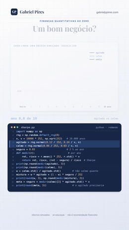

<!-- README escrito à mão. O notebook sai de work/notebook.py (dados de work/baixa_dados.py) e a nota técnica, de nota.md. -->



# O índice de Sharpe

**O dobro do retorno por oito vezes o risco é um bom negócio?**

Série *Finanças Quantitativas do Zero*

[](sharpe.ipynb)
[](sharpe_nota_tecnica.pdf)
[](#-o-teste-que-ninguém-pediu)
[](#-como-rodar)

Retorno não se compara sem risco, e risco não se compara sem retorno. **O índice de Sharpe junta os dois num número só**: o retorno extra sobre uma conta segura, dividido pela volatilidade. É a régua que todo gestor, todo ranking de fundos e toda mesa usam, e é também a que mais engana quando é medida com poucos anos de dados.

**[📓 Abrir o notebook](sharpe.ipynb)** · **[📄 Ler a nota técnica](sharpe_nota_tecnica.pdf)** · **[🎬 Ver no Instagram](https://instagram.com/gabrielp.piress)** · **[🗺️ Todos os vídeos](https://github.com/gabrielp18/financas-quant-do-zero)**

<br clear="right">

## ⚡ O vídeo em 30 segundos

Dois investimentos simulados por 10.000 anos. Uma conta segura paga 3 % ao ano.

| | Agitado | Calmo |
|---|---|---|
| Retorno ao ano | 11,7 % | 6,0 % |
| Volatilidade (risco) | 24,0 % | 3,0 % |
| Passo 1: extra sobre o seguro | 8,7 % | 3,0 % |
| **Passo 2: extra ÷ risco = índice de Sharpe** | **0,36** | **0,99** |

O dobro do retorno, oito vezes o risco. Para comparar de forma justa, ponha só **1/8 do dinheiro no agitado** e o resto na conta segura: o risco cai para os mesmos 3 % do calmo, mas o retorno fica em 4,1 %, contra 6,0 %. E a mistura continua marcando 0,36, porque **misturar com caixa nunca muda o Sharpe**. Para valer tanto quanto o calmo, o agitado teria que render **26,8 %** ao ano.

**Por unidade de risco, o calmo paga quase três vezes mais.**

## 🐍 O código da tela

As 16 linhas que aparecem digitadas no vídeo. O notebook começa exatamente por elas.

```python
import numpy as np
rng = np.random.default_rng(8)
n, v = 10000 * 252, np.sqrt(252)   # 10.000 anos
agitado = rng.normal(0.12 / 252, 0.24 / v, n)
calmo = rng.normal(0.06 / 252, 0.03 / v, n)
seguro = 0.03                      # 3 % ao ano
def medir(r):                       # por ano
    ret, risco = r.mean() * 252, r.std() * v
    return ret, risco, (ret - seguro) / risco  # Sharpe
print(np.round(medir(agitado), 3))
print(np.round(medir(calmo), 3))
w = calmo.std() / agitado.std()        # tão calmo quanto
mistura = w * agitado + (1 - w) * seguro / 252
print(round(w, 3), np.round(medir(mistura), 3))
meta = seguro + medir(calmo)[2] * agitado.std() * v
print(round(meta, 3))                  # o agitado precisaria
```

```text
[0.117 0.24  0.363]
[0.06  0.03  0.993]
0.125 [0.041 0.03  0.363]
0.268
```

## 🎯 O teste que ninguém pediu

O vídeo usa 10.000 anos para ter certeza. Ninguém tem 10.000 anos de dados. Quanto erra um Sharpe medido com os dados que existem? Lo (2002) responde:

$$
\text{EP}(\widehat{SR}) \approx \sqrt{\frac{1 + SR^2/2}{T}}
$$

Com dados diários, isso dá **erro-padrão de 0,32 numa década**, qualquer que seja o investimento. Nas 1.000 décadas do vídeo, o Sharpe medido do agitado vai de −0,13 a 0,88, e em **8,5 % delas ele parece melhor que o calmo**.

Agora com dado real: o **Ibovespa contra o CDI**, dia a dia, de 1995 a 16/10/2026.

| Período | Sharpe | IC de 95 % (bootstrap em blocos) |
|---|---|---|
| 1995–2004 | 0,10 | −0,47 a 0,68 |
| 2005–2014 | −0,02 | −0,57 a 0,54 |
| 2015–2026 | 0,22 | −0,37 a 0,83 |
| **1995–2026** | **0,10** | **−0,25 a 0,42** |

Nenhum período distingue o Ibovespa do CDI. Provar um Sharpe de 0,10 exigiria **427 anos** de dados. E tem mais:

1. 📉 **Sharpe positivo, perdeu do CDI.** Desde 1995, o Ibovespa multiplicou o capital por 47,8; o CDI, por 84,5. O Sharpe usa a média aritmética, o patrimônio cresce pela geométrica, e com 31,3 % de volatilidade só ganha do CDI no acumulado quem tem Sharpe acima de σ/2 = 0,16.
2. 🎲 **38 ações da B3 desde 2015.** 35 com Sharpe positivo, mediana de 0,30. Só uma, PRIO3 (0,82), tem intervalo que exclui o zero, e nem ela passa na correção para 38 testes.
3. 🔁 **O Sharpe não persiste.** A correlação de postos entre o Sharpe de 2015–2020 e o de 2021–2026 é **−0,19**.

> Uma década de dados mede o Sharpe com erro-padrão de 0,32. Quem compara gestores por cinco anos de cota está comparando, em boa parte, sorte.

## 🗺️ O que tem no notebook

| Seção | O que você leva |
|:-:|---|
| 0 | O código da tela (`sharpe.py`), linha por linha, e um `assert` para cada número do vídeo |
| 1 | Retorno e risco por ano, e 1.000 décadas de cada investimento |
| 2 | Os dois passos: o Sharpe é uma inclinação |
| 3 | Misturar com caixa não muda o Sharpe; a meta de 26,8 %; Tobin e a carteira de maior Sharpe |
| 4 | Quanto erra o Sharpe de uma década (Lo, 2002), e quantos anos para provar um Sharpe |
| 5 | Anualizar: a raiz de 252 e o que a autocorrelação faz com ela |
| 6 | 🇧🇷 O Ibovespa contra o CDI desde 1995, e por que um Sharpe positivo perdeu do CDI |
| 7 | 🇧🇷 38 ações da B3 desde 2015: quantas têm Sharpe diferente de zero? |
| 8 | 🏦 **Mesa:** alavancar não é de graça, e o mini-índice que já embute o CDI |
| 9 | 💼 **Investidor:** dois fundos, dois Sharpes (cotas da CVM) |
| 10 | O que o Sharpe esconde: vender put fora do dinheiro |
| 11 | O que o Sharpe não vê + exercícios |

## 📐 As dez equações

As mesmas no notebook e na nota técnica. A nota continua a numeração até a (23), com as demonstrações.

| | Equação | O que ela diz |
|:-:|---|---|
| (1) | $\mu = 252\,\bar r$, $\sigma = \sqrt{252}\,s$ | a média cresce com o tempo; o risco, com a raiz do tempo |
| (2) | $SR = (\mu - r_f)/\sigma$ | retorno extra por unidade de risco |
| (3) | $SR_w = SR$ para $w > 0$ | misturar com caixa não muda o Sharpe |
| (4) | $\mu^* = r_f + SR_{\text{calmo}}\,\sigma_{\text{agitado}}$ | os 26,8 % que o agitado precisaria |
| (5) | $SR_{\max}^2 = SR_1^2 + SR_2^2$ | dois investimentos independentes se somam ao quadrado |
| (6) | $\text{EP} \approx \sqrt{(1 + SR^2/2)/T}$ | o erro de medida (Lo, 2002) |
| (7) | $\text{anos} \approx (2/SR)^2$ | quanto tempo para provar um Sharpe |
| (8) | $\eta(q) = q/\sqrt{q + 2\sum_k (q-k)\rho_k}$ | anualizar quando os meses se arrastam |
| (9) | $g - r_f \approx \sigma(SR - \sigma/2)$ | Sharpe positivo não garante ganhar no acumulado |
| (10) | $SR_L = SR - \frac{L-1}{L}\frac{s}{\sigma}$ | alavancar pagando spread |

## 💸 Dois usos que valem dinheiro

**🏦 Na mesa.** A meta de 26,8 % do vídeo é o calmo alavancado 8 vezes, tomando emprestado à taxa segura. Pagando spread, a conta muda rápido:

| Spread sobre a taxa segura | Calmo alavancado ao risco do agitado rende | Sharpe |
|---|---|---|
| 0 | 26,8 % | 0,99 |
| 1 ponto | 19,8 % | 0,70 |
| **2,16 pontos** | **11,7 %, o mesmo que o agitado** | **0,36** |
| 3 pontos | 5,8 % | 0,12 |

No futuro de Ibovespa, o preço já embute o juro, e a reta do vídeo volta a valer com o CDI no lugar dos 3 %. Com R\$ 1 milhão e alvo de 15 % de volatilidade, são **19 contratos de mini-índice** (WIN, com o índice a 205.430 pontos em 16/10/2026): R\$ 9.450 de oscilação num dia típico, R\$ 3.800 a cada 1.000 pontos. O número de contratos escolhe o ponto da reta; o mercado escolhe a inclinação.

**💼 Na escolha do fundo.** Cotas mensais de 155 fundos da CVM, de out/2019 a set/2026 (medianas):

| | Crédito privado | Ações | Multimercado |
|---|---|---|---|
| Sharpe nos últimos 5 anos | 0,97 | 0,00 | 0,14 |
| Autocorrelação de um mês | 0,36 | −0,02 | 0,04 |
| Sharpe corrigido (Lo, 2002) | 0,60 | 0,00 | 0,16 |
| Sharpe em 7 anos, com março de 2020 | 0,27 | 0,11 | 0,32 |

O crédito privado parece outro mundo até você olhar a autocorrelação (cota suave) e o mês ruim: em **março de 2020**, 42 dos 43 fundos de crédito renderam abaixo do CDI, e um único mês apagou **28 meses** do prêmio mediano. **Compare Sharpe só dentro da mesma classe, e numa janela que tenha um mês ruim.**

## 📄 A nota técnica

16 páginas em A4 com nove proposições demonstradas. Três que costumam surpreender:

- 🧮 **A carteira de maior Sharpe sai de Cauchy-Schwarz.** Com investimentos independentes, os Sharpes se somam ao quadrado: o agitado, pior sozinho, leva a carteira de 0,99 para 1,06 com só 4,4 % do dinheiro.
- 📉 **Sharpe positivo não basta para ganhar do CDI.** No acumulado, é preciso Sharpe maior que metade da volatilidade. A alavancagem que maximiza o crescimento (Kelly) põe só 31 % do dinheiro no Ibovespa.
- 🧊 **Cota suave infla o Sharpe, e Lo sabe desfazer.** Se o retorno publicado é a média de dois meses, a raiz de 12 exagera o Sharpe anual em 41 %; a correção de Lo devolve a 2 % do verdadeiro.

**[📄 Baixar a nota técnica (PDF)](sharpe_nota_tecnica.pdf)**

## 🧩 Teste você mesmo

<details>
<summary><b>1.</b> Um fundo rende 14 % ao ano com volatilidade de 8 %, e o CDI está em 12 %. Qual o Sharpe? E de metade no fundo e metade no CDI?</summary>
<br>
(14 − 12)/8 = 0,25. A metade rende 13 % com 4 % de volatilidade: (13 − 12)/4 = 0,25. Misturar com caixa não muda o Sharpe.
</details>

<details>
<summary><b>2.</b> Uma estratégia tem Sharpe verdadeiro de 0,5. Quantos anos de dados para ela ficar a dois erros-padrão de zero?</summary>
<br>
(2/0,5)² = 16 anos. Dados intradiários não encurtam esse prazo: só o número de anos importa.
</details>

<details>
<summary><b>3.</b> Um fundo tem Sharpe mensal de 0,30 e autocorrelação de um mês de 0,4. Qual o Sharpe anual?</summary>
<br>
Pela raiz de 12, 1,039. Corrigido pela autocorrelação (Lo, 2002, num AR(1)), 0,709: a raiz de 12 exagera 47 %.
</details>

<details>
<summary><b>4.</b> Você alavanca 3 vezes um investimento com volatilidade de 10 % e Sharpe de 0,8, pagando 2 pontos acima da taxa segura. Qual o Sharpe da posição?</summary>
<br>
0,8 − (2/3) × 0,02/0,10 = 0,667.
</details>

<details>
<summary><b>5.</b> Um índice tem volatilidade de 25 % ao ano. Qual o Sharpe mínimo para ele ganhar da taxa segura no acumulado?</summary>
<br>
Metade da volatilidade: 0,125.
</details>

## 🚀 Como rodar

Na sua máquina, de dentro desta pasta (o notebook lê os dados de `dados/` e não baixa nada):

```bash
pip install numpy pandas matplotlib jupyterlab
jupyter lab sharpe.ipynb
```

No Google Colab, rode isto numa célula antes:

```python
!git clone -q https://github.com/gabrielp18/financas-quant-do-zero.git
%cd financas-quant-do-zero/codigos/05_sharpe
```

## 📂 Nesta pasta

| Arquivo | O que é |
|---|---|
| [`sharpe.ipynb`](sharpe.ipynb) | o notebook, executado, com 9 gráficos e um `assert` para cada número do vídeo |
| [`sharpe_nota_tecnica.pdf`](sharpe_nota_tecnica.pdf) | a nota técnica: demonstrações, tabelas, exercícios e referências |
| [`dados/ibovespa.csv`](dados/ibovespa.csv) | fechamento diário do Ibovespa, de 02/01/1995 a 16/10/2026 (Yahoo Finance) |
| [`dados/cdi_diario.csv`](dados/cdi_diario.csv) | CDI em % ao dia útil, de 02/01/1995 a 16/10/2026 ([Banco Central, SGS 12](https://www3.bcb.gov.br/sgspub/)) |
| [`dados/acoes_b3.csv`](dados/acoes_b3.csv) | preços ajustados por proventos de 38 ações da B3 e do Ibovespa, de 02/01/2015 a 09/10/2026 (Yahoo Finance) |
| [`dados/fundos_cvm_mensal.csv`](dados/fundos_cvm_mensal.csv) | retorno mensal da cota de 155 fundos, de out/2019 a set/2026, sem nome nem CNPJ ([CVM, Informe Diário](https://dados.cvm.gov.br/)) |
| `img/abertura.gif` | a abertura do vídeo, aí em cima |

---

<sub>O vídeo é inspirado em *Quant Finance from Scratch*, de [@quantfinancetogo](https://instagram.com/quantfinancetogo). Simulações nas seções 0 a 5 e 10 do notebook; dados reais (Yahoo Finance, Banco Central e CVM) nas seções 6 a 9. Só educação, não é recomendação de investimento. Feito por [Gabriel Pires](https://gabrielppires.com) · [@gabrielp.piress](https://instagram.com/gabrielp.piress)</sub>
