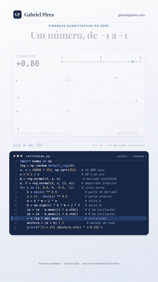

# Correlação

**Por que a mesma carteira meio a meio pode oscilar 19,0 %, 14,1 % ou 10,0 %?**

Série *Finanças Quantitativas do Zero*

[](correlacao.ipynb)
[](correlacao_nota_tecnica.pdf)
[-crise_de_2020_na_B3-1B7A4A)](#-o-teste-com-dado-real-tudo-cai-junto-em-2020-foi-contágio)
[](#-como-rodar)

Dois ativos oscilam 20 % ao ano cada um. Juntos, meio a meio, podem oscilar quase o mesmo ou a metade disso. **Quem decide é um número entre −1 e +1: a correlação.** Ela é a média dos produtos dos movimentos dos dois ativos medidos em oscilações típicas, e é o que separa uma carteira diversificada de duas apostas na mesma coisa.

**[📓 Abrir o notebook](correlacao.ipynb)** · **[📄 Ler a nota técnica](correlacao_nota_tecnica.pdf)** · **[🎬 Ver no Instagram](https://instagram.com/gabrielp.piress)** · **[🗺️ Todos os vídeos](https://github.com/gabrielp18/financas-quant-do-zero)**

<br clear="right">

## ⚡ O episódio em 30 segundos

Dois ativos simulados, A e B, recebem todo dia o mesmo empurrão de um **mercado escondido** e, cada um, um empurrão próprio com metade do tamanho. Ponha cada dia num mapa: os empurrões próprios sozinhos fariam uma nuvem redonda; o mercado compartilhado estica a nuvem ao longo de uma linha que sobe.

A correlação transforma isso num número. Meça cada movimento em oscilações típicas e multiplique os dois movimentos de cada dia: mesmo sentido dá mais, sentidos opostos dão menos. A média é a correlação. No dia 1, (−1,60) × (−1,63) = +2,60; no dia 146, (+0,65) × (−0,66) = −0,43. Em 10 mil anos simulados, esses dois marcam **+0,80**.

| Correlação | Risco da carteira meio a meio (cada ativo: 20 % ao ano) |
|---|---|
| +1,00 | 20,0 % |
| **+0,80** | **19,0 %** |
| 0 | 14,1 % |
| −0,50 | 10,0 % |
| −1,00 | 0,0 % |

**A correlação nunca diz qual causa o outro.** Aqui nenhum causa: o mercado escondido move os dois.

## 🐍 O código da tela

As 16 linhas que aparecem digitadas no vídeo. O notebook começa exatamente por elas.

```python
import numpy as np
rng = np.random.default_rng(10)
n, v = 10000 * 252, np.sqrt(252)   # 10.000 anos
s = 0.2 / v                        # 20 % ao ano
m = rng.normal(0, s, n)             # mercado escondido
e, f = rng.normal(0, s, (2, n))    # empurrões próprios
for c in (1, 0.8, 0, -0.5, -1):    # cinco pares
    k = abs(c) ** 0.5                # parte do mercado
    j = (1 - abs(c)) ** 0.5          # parte própria
    a = k * m + j * e                # ativo A
    b = np.sign(c) * k * m + j * f   # ativo B
    za = (a - a.mean()) / a.std()    # A em oscilações
    zb = (b - b.mean()) / b.std()    # B em oscilações
    r = (za * zb).mean()             # correlação
    mistura = (a + b) / 2             # metade em cada
    print(f'{r:+.2f} {mistura.std() * v:6.1%}')
```

```text
+1.00  20.0%
+0.80  19.0%
+0.00  14.1%
-0.50  10.0%
-1.00   0.0%
```

## 🎯 O teste com dado real: "tudo cai junto" em 2020 foi contágio?

Em março de 2020, as ações da B3 caíram juntas como nunca. A correlação de cada uma das 38 ações com o Ibovespa saltou de 0,548 (um ano antes do carnaval) para **0,828** (de 26/02 a 30/04/2020), e subiu em **todas as 38**. Um teste ingênuo diria: contágio.

**Forbes e Rigobon (2002)** mostraram que isso é viesado: quando o mercado fica mais volátil, a correlação sobe sozinha, sem elo novo nenhum. A correção deles é

$$
\rho^{*} = \frac{\rho_{\text{crise}}}{\sqrt{1 + \delta\,(1-\rho_{\text{crise}}^2)}}, \qquad 1 + \delta = \frac{\sigma^2_{\text{Ibovespa, crise}}}{\sigma^2_{\text{Ibovespa, calma}}} = 26{,}8
$$

| Correlação com o Ibovespa (média das 38) | Calma | Crise | Ajustada por Forbes-Rigobon | Prevista sem elo novo |
|---|---|---|---|---|
| 26/02 a 30/04/2020 | 0,548 | **0,828** | 0,304 | **0,801** |

O resultado tem duas partes, e a segunda é a que ninguém conta:

1. ✅ **Não houve contágio.** Os betas mal mudaram (0,90 → 0,97), a correlação entre os resíduos das ações ficou em +0,01 na calma e na crise, e a correlação prevista só pelo mercado mais volátil, 0,801, fica a +0,028 da observada (intervalo de 95 % em blocos de −0,008 a +0,059: inclui o zero).
2. ⚠️ **Mas a correção de Forbes e Rigobon, sozinha, passa do ponto.** Ajustada, a correlação da crise vira 0,304: **abaixo** da calma em 37 das 38 ações. A hipótese que falha é a de risco próprio constante: em 2020, a variância própria das empresas ficou 4,9 vezes maior, enquanto a do Ibovespa ficou 26,8 vezes. Com as duas na conta, a previsão bate.

> Para quem tem a carteira, a mecânica não consola: a correlação **medida** entre pares de ações foi de 0,31 para 0,69, e a diversificação entregou menos justamente quando era mais necessária.

## 🗺️ O que tem no notebook

| Seção | O que você leva |
|:-:|---|
| 0 | O código da tela (`correlacao.py`) e um `assert` para cada número do vídeo |
| 1 | A média dos produtos: os dias 1 e 146 e os quadrantes |
| 2 | Por que nunca passa de ±1 |
| 3 | O mercado escondido: de onde vem o 0,80, e por que correlação não é causa |
| 4 | Quanto dado ela pede: a média corrida do vídeo, o erro de Fisher e 10 mil anos de conferência |
| 5 | O risco da mistura meio a meio e o piso da diversificação |
| 6 | Zero não é independência: $y = x^2$ e os dias de pânico |
| 7 | 🇧🇷 Petrobras ON × PN, Itaú × Bradesco, Petrobras × Vale e Ibovespa × dólar, ano a ano |
| 8 | 🇧🇷 O erro da correlação diária: Fisher × bootstrap em blocos |
| 9 | 🇧🇷 As 38 ações: quanto da correlação é o mercado |
| 10 | 🇧🇷 **Replicação:** Forbes e Rigobon (2002) na crise de 2020 |
| 11 | 🏦 **Mesa:** hedge de variância mínima de R\$ 1 milhão em Itaú |
| 12 | 💰 **Investidor:** meio Ibovespa, meio dólar, ano a ano desde 1999 |
| 13 | O que a correlação não vê + exercícios |

## 📐 As onze equações

As mesmas no notebook e na nota técnica. A nota continua a numeração até a (21), com as demonstrações.

| | Equação | O que ela diz |
|:-:|---|---|
| (1) | $\rho = \frac{1}{n}\sum_t z_{A,t}\,z_{B,t}$ | a média dos produtos das oscilações típicas |
| (2) | $\rho = \mathrm{Cov}(A,B)/(\sigma_A\sigma_B)$ | a mesma coisa, na definição de Pearson |
| (3) | $\frac{1}{n}\sum_t (z_A \mp z_B)^2 = 2(1 \mp \rho) \ge 0$ | por que fica entre −1 e +1 |
| (4) | $\rho_{AB} = \beta_A\beta_B\sigma_M^2/(\sigma_A\sigma_B)$ | o mercado escondido faz a correlação |
| (5) | $\sqrt{(1+\rho^2)/n}$ e $(1-\rho^2)/\sqrt{n}$ | o erro da média corrida e o da correlação de um ano |
| (6) | $\mathrm{atanh}\,\hat\rho \approx \mathcal{N}(\mathrm{atanh}\,\rho,\,1/(n-3))$ | o intervalo de Fisher |
| (7) | $\sigma_{50/50} = \sigma\sqrt{(1+\rho)/2}$ | 19,0 %, 14,1 % e 10,0 % |
| (8) | $\sigma_{1/N}^2 = \sigma^2[1/N + (1-1/N)\bar\rho]$ | o piso da diversificação, $\sigma\sqrt{\bar\rho}$ |
| (9) | $\rho^* = \rho/\sqrt{1+\delta(1-\rho^2)}$ | a correção de Forbes e Rigobon |
| (10) | $\rho_h^2 = \frac{\rho_l^2(1+\delta)}{\rho_l^2(1+\delta) + (1-\rho_l^2)(1+\gamma)}$ | a mesma, com o risco próprio mudando |
| (11) | $h^* = \rho\,\sigma_A/\sigma_B$ | o hedge de variância mínima tira $\rho^2$ da variância |

## 💸 Dois usos que valem dinheiro

**🏦 Na mesa.** Comprado em R\$ 1 milhão de Itaú, quanto vender para tirar o risco? Pela eq. (11), com a correlação de 2015 a 2026:

| Vendendo… | Correlação | Quanto vender | Variância tirada | Desvio tirado |
|---|---|---|---|---|
| Bradesco (BBDC4) | 0,829 | R\$ 721.069 | 68,7 % | 44,1 % |
| BOVA11 | 0,783 | R\$ 1.000.819 | 61,3 % | 37,8 % |

Correlação de 0,83 parece quase 1, mas tira só 44 % do desvio: para tirar 90 %, seria preciso 0,995. Fora da amostra (h* reestimado todo mês com o ano anterior, de 2016 a 2026), o hedge com Bradesco levou o VaR de 95 % de um dia de R\$ 30.914 para R\$ 17.301. Mas em **2024**, quando a correlação de Itaú e Bradesco caiu para 0,53, ele tirou só 15 % da variância; o hedge com BOVA11, 43 %. **O concorrente protege contra o setor; o índice, contra as surpresas do concorrente.**

**💰 Para o investidor.** Meio Ibovespa, meio dólar (PTAX), de 1999 a 16/10/2026:

| Ano | Ibovespa | Dólar | 50/50 |
|---|---|---|---|
| 2002 | −17,0 % | +52,3 % | +17,6 % |
| 2008 | −41,2 % | +31,9 % | −4,6 % |
| 2015 | −13,3 % | +47,0 % | +16,8 % |

A correlação diária dos dois foi negativa em 27 de 28 anos, e **em todos os 28 a mistura oscilou menos que a média dos dois riscos**. Detalhe que muda o número: a PTAX sai até as 13h e o Ibovespa fecha no fim da tarde. Medida no diário, a correlação é −0,30; no semanal, −0,51; no mensal, −0,64. **Medida no diário, a proteção do dólar parece menor do que é.**

## 📄 A nota técnica

16 páginas em A4 com doze proposições demonstradas. Três que costumam surpreender:

- 🎲 **A correlação diz em quantos dias os dois ativos andam para o mesmo lado:** $\tfrac12 + \arcsin(\rho)/\pi$. Com 0,80, são 79,5 % dos dias, exatamente o que a simulação mostra; na B3, a fórmula erra no máximo 2,4 pontos.
- 📏 **A média corrida do vídeo erra muito mais que a correlação de um ano:** 0,081 contra 0,023, porque medir as oscilações com o desvio do próprio ano cancela boa parte do ruído. O 0,72 do primeiro ano não é defeito, é azar: 16 % dos anos simulados ficam abaixo dele.
- 📉 **Com dado diário de verdade, o erro de Fisher é otimista:** o bootstrap em blocos dá um erro 1,7 a 3,4 vezes maior, e a correlação de Itaú × Bradesco oscila 0,117 de um ano para o outro, contra 0,020 do erro de Fisher para um ano. A nota mostra de onde vem cada parte: caudas grossas e uma correlação que anda.

**[📄 Baixar a nota técnica (PDF)](correlacao_nota_tecnica.pdf)**

## 🧩 Teste você mesmo

<details>
<summary><b>1.</b> Dois ativos oscilam 30 % e 10 % ao ano, com correlação −0,20. Qual o risco da carteira meio a meio?</summary>
<br>
√(0,25·0,09 + 0,25·0,01 + 2·0,25·(−0,2)·0,3·0,1) = 14,8 %, contra 20,0 % da média dos dois riscos.
</details>

<details>
<summary><b>2.</b> Com ações de 35 % ao ano e correlação média 0,35, qual o piso de risco de uma carteira de pesos iguais? E com 10 ações?</summary>
<br>
Piso: 35 % × √0,35 = 20,7 %. Com 10 ações: 35 % × √(0,1 + 0,9·0,35) = 22,5 %.
</details>

<details>
<summary><b>3.</b> Uma correlação de 0,60 foi medida com 100 dias. Qual o intervalo de 95 % de Fisher?</summary>
<br>
atanh 0,6 = 0,6931 ± 1,96/√97, de volta pela tangente hiperbólica: de 0,46 a 0,71. Com dado diário, desconfie: nos pares da B3, o erro em blocos foi 1,7 a 3,4 vezes o de Fisher.
</details>

<details>
<summary><b>4.</b> Na calma, uma ação tem correlação 0,50 com o índice. Na crise, a variância do índice quadruplica e o risco próprio fica igual. Qual a correlação esperada?</summary>
<br>
0,756, sem elo novo nenhum. Se o risco próprio também dobrar, 0,632.
</details>

<details>
<summary><b>5.</b> Correlação de 0,9, ativo A a 30 % e B a 25 % ao ano. Quanto vender de B para proteger R&#36; 500 mil de A?</summary>
<br>
h* = 0,9 × 30/25 = 1,08: vender R&#36; 540.000. Sobra 30 % × √(1 − 0,81) = 13,1 % ao ano.
</details>

## 🚀 Como rodar

Na sua máquina, de dentro desta pasta (o notebook lê os dados de `dados/`):

```bash
pip install numpy pandas matplotlib jupyterlab
jupyter lab correlacao.ipynb
```

No Google Colab, rode isto numa célula antes:

```python
!git clone -q https://github.com/gabrielp18/financas-quant-do-zero.git
%cd financas-quant-do-zero/codigos/06_correlacao
```

O notebook não baixa nada; roda em cerca de um minuto, quase todo no bootstrap.

## 📂 Nesta pasta

| Arquivo | O que é |
|---|---|
| [`correlacao.ipynb`](correlacao.ipynb) | o notebook, executado, com 10 gráficos e um `assert` para cada número do vídeo |
| [`correlacao_nota_tecnica.pdf`](correlacao_nota_tecnica.pdf) | a nota técnica: demonstrações, tabelas, exercícios e referências |
| [`dados/pares_b3.csv`](dados/pares_b3.csv) | PETR3, PETR4, ITUB4, BBDC4, VALE3 e BOVA11, fechamento ajustado, 02/01/2015 a 16/10/2026 (Yahoo Finance) |
| [`dados/acoes_b3.csv`](dados/acoes_b3.csv) | as 38 ações do vídeo da diversificação, fechamento ajustado, 02/01/2015 a 09/10/2026 (Yahoo Finance) |
| [`dados/ibovespa.csv`](dados/ibovespa.csv) | Ibovespa (`^BVSP`, Yahoo Finance), 04/01/1999 a 16/10/2026 |
| [`dados/ptax.csv`](dados/ptax.csv) | dólar PTAX de venda ([Banco Central, SGS 1](https://www3.bcb.gov.br/sgspub/)), 04/01/1999 a 16/10/2026 |
| `img/abertura.gif` | a abertura do vídeo, aí em cima |

---

<sub>O vídeo é inspirado em *Quant Finance from Scratch*, de [@quantfinancetogo](https://instagram.com/quantfinancetogo). Retornos simulados nas seções 0 a 6 do notebook; dados reais do Yahoo Finance e do Banco Central nas seções 7 a 12. Só educação, não é recomendação de investimento. Feito por [Gabriel Pires](https://gabrielppires.com) · [@gabrielp.piress](https://instagram.com/gabrielp.piress)</sub>
